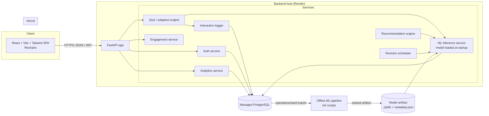
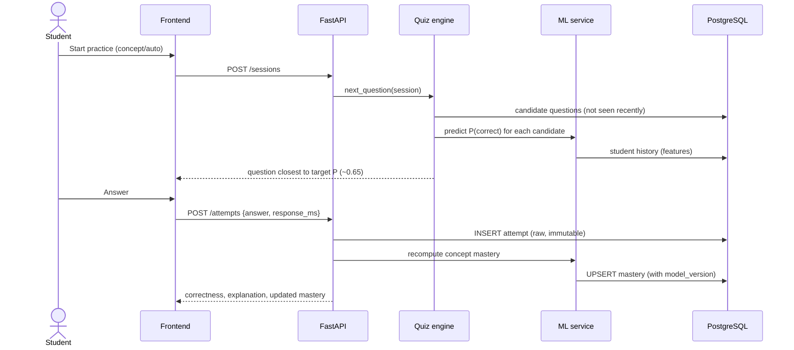
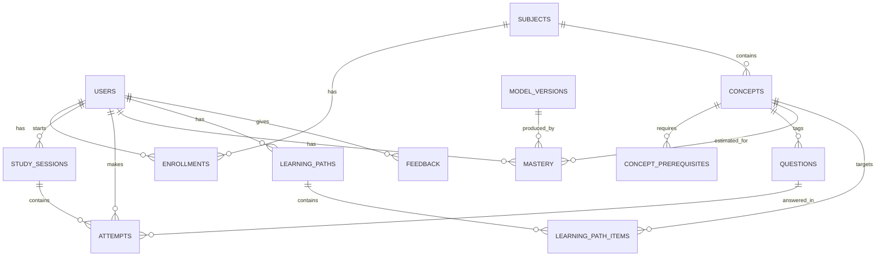
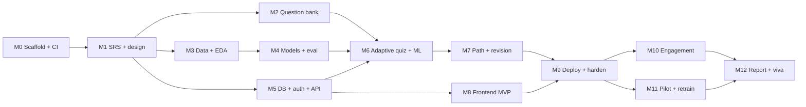

# MENTORX — Project Plan (v0.1)

> Status: **M0, M1, M3–M8 done · M2 drafted** (285 questions awaiting team review). ML results: [ml-report.md](ml-report.md).
> Plan date: 2026-11-08 (v0.2). There's no fixed deadline: the goal is the best possible product, built in milestone order. Each milestone is finished, tested and deployed before the next one starts.
>
> **Decisions made:** MVP subject = **Machine Learning** · Frontend = **TypeScript** · No ethics approval required by the college (consent + privacy safeguards stay in place anyway).

Contents
1. Feasibility analysis
2. Refined scope and MVP
3. System architecture
4. Database schema
5. Datasets and ML methodology
6. Module-by-module roadmap
7. Timeline
8. Repository structure
9. Initial setup
10. Open decisions

---

## 1. Feasibility analysis

### 1.1 Verdict
**Feasible for a 4-person team, if it's built as one subject first and the pilot starts as soon as the MVP is deployed.** Trying to build every feature for 5 subjects at once is the main risk. The plan below separates the MVP from the extensions that follow it.

### 1.2 Technical feasibility

| Area | Risk | Why | Mitigation |
|---|---|---|---|
| Web app (React + FastAPI + Postgres) | Low | Standard, well-documented stack | Scaffold first (M0), deploy a "hello world" early |
| Knowledge-tracing models (LR, GBM, BKT) | Low–Medium | Methods are well established; libraries exist (scikit-learn, XGBoost, pyBKT) | Benchmark on public data first |
| **Domain mismatch** | **High** | Public KT datasets cover **math** (ASSISTments) and **English/TOEIC** (EdNet), not Machine Learning | Use concept-agnostic features so a model trained on public data can transfer; retrain on MENTORX data once it exists; report the two results separately |
| **Cold start** | **High** | New students and new questions have no history | Diagnostic test + difficulty priors from authors + model features that work with zero history |
| **Question bank** | **High (effort)** | Good MCQs with concept tags take time to write and review | One subject, ~200–250 questions, divided across all 4 members, reviewed by a peer |
| Real-user data volume | Medium | A pilot of 30–60 students gives roughly 3k–10k attempts: enough to retrain LR/BKT, small for GBM, too small for DKT | Present MENTORX-data results with confidence intervals; treat DKT as public-data-only research |
| Free hosting limits | Medium | Free backend tiers may sleep when idle (slow first request); some free Postgres tiers expire. **Check current Render/Neon/Vercel free-tier terms before choosing.** | Keep the model small and loaded in-process; use a non-expiring managed Postgres (e.g. Neon) |
| Causal claims about learning | Medium | Improved scores ≠ proof the ML helped | Pre/post test with parallel forms + an adaptive vs. non-adaptive comparison; report limitations honestly |

### 1.3 Operational / ethical feasibility
- Student data is personal data. Collect only the minimum: name/email, attempts, timings. Get explicit consent at signup, offer account + data deletion, and use only pseudonymised exports for ML training.
- The college doesn't require ethics approval for the pilot. If the work is ever submitted for publication, check the venue's requirements first.
- Write all questions yourselves. Don't paste copyrighted textbook or exam questions verbatim.

### 1.4 Value
A real problem (one-size-fits-all practice) with a measurable outcome. It shows genuine ML (trained, compared, deployed models that drive decisions) and genuine SE (requirements, design, tests, CI/CD, deployment).

---

## 2. Refined scope and MVP

### 2.1 MVP (ships first, deployed, then the pilot starts)
1. **One subject: Machine Learning.** 19 concepts with a prerequisite graph (see [question_bank/machine_learning/concepts.yaml](../question_bank/machine_learning/concepts.yaml)), ~250 MCQs at 3 difficulty levels. A nice side effect: the platform teaches the same subject whose methods it uses, which is a good story for the ML course evaluation.
2. Registration and login (JWT), profile, consent, subject enrolment.
3. A 15–20-question diagnostic test that covers every concept.
4. An adaptive quiz engine driven by the ML model's predicted P(correct).
5. Concept mastery estimated by the model and updated after every attempt.
6. A learning path: next concept to study, with prerequisite gating and a suggested difficulty.
7. A dashboard: overall progress, concept mastery map, strong/weak concepts, accuracy trend, quiz history, activity heatmap.
8. Revision queue: concepts whose *predicted* mastery has decayed below a threshold.
9. Streaks + a daily goal (questions answered *thoughtfully*, see §5.8).
10. In-app feedback form.
11. CI (tests + lint) and a public deployment.

### 2.2 Stretch goals (only after the MVP works)
- Second subject (DSA or OS). The pipeline is subject-agnostic, so this is mostly content work.
- Achievements, adaptive challenges, weekly in-app report.
- Revision calendar UI with scheduled sessions.
- DKT (PyTorch) benchmark on public data.
- Admin panel for question authoring.
- Teacher/class view.

### 2.3 Out of scope (state this in the SRS)
- Open-ended/code-evaluated questions (MCQ only).
- LLM-generated questions or chat tutor.
- Native mobile apps (a responsive web app only).
- Proving long-term learning gains (the pilot is too short).

---

## 3. System architecture

### 3.1 High-level



### 3.2 Layered backend (one FastAPI app, modular inside)

```
api/ (routers: HTTP only, validation via Pydantic)
  └─► services/ (business logic: quiz, recommendation, revision, analytics, engagement)
        ├─► ml/ (feature builder + model wrapper; same code used in training & serving)
        └─► repositories/ (SQLAlchemy queries)
              └─► db/ (models, session, Alembic migrations)
```

Why a modular monolith and not microservices: 4 people, one deployment, free hosting. The modules talk through Python interfaces, so the ML service could be split out later if needed.

### 3.3 The core loop (sequence)



### 3.4 Key design rule: the same feature code for training and serving
`ml/features.py` is imported by both the offline training scripts and the backend. That stops train/serve skew and guarantees features only use **past** attempts (no leakage).

---

## 4. Database schema

> **Superseded in detail by [design/database.md](design/database.md)**, the authoritative schema. M1 added refresh tokens, served-question state on sessions, `peak_mastery`, mastery snapshots, pilot fields and question flags. The summary below is kept for overview.

PostgreSQL, managed by SQLAlchemy 2.x + Alembic migrations. The eight required tables plus four supporting ones (marked *).



### 4.1 Tables

**users**
| column | type | notes |
|---|---|---|
| id | UUID PK | |
| email | CITEXT UNIQUE NOT NULL | |
| password_hash | TEXT NOT NULL | argon2/bcrypt, never plaintext |
| full_name | VARCHAR(120) | |
| role | VARCHAR(20) NOT NULL DEFAULT 'student' | CHECK in ('student','admin') |
| consent_research | BOOLEAN NOT NULL DEFAULT false | data may be used for model training |
| daily_goal | SMALLINT NOT NULL DEFAULT 10 | CHECK 1–100 |
| timezone | VARCHAR(64) DEFAULT 'Asia/Kolkata' | for streaks |
| created_at, updated_at | TIMESTAMPTZ | |

**subjects**: id SERIAL PK, code VARCHAR(20) UNIQUE ('ML'), name, description, is_active.

**enrollments\***: user_id FK, subject_id FK, enrolled_at, diagnostic_completed_at NULL. PK(user_id, subject_id).

**concepts**: id SERIAL PK, subject_id FK NOT NULL, code VARCHAR(40) (e.g. `ml.regularization`), name, description, display_order. UNIQUE(subject_id, code).

**concept_prerequisites\***: concept_id FK, prerequisite_id FK, PK(both), CHECK(concept_id <> prerequisite_id). Must stay a DAG (checked in the service layer + tests).

**questions**
| column | type | notes |
|---|---|---|
| id | SERIAL PK | |
| concept_id | FK NOT NULL | primary concept (one concept per question keeps BKT simple) |
| stem | TEXT NOT NULL | markdown |
| options | JSONB NOT NULL | `[{"key":"A","text":"..."}]`, 4 options |
| correct_key | CHAR(1) NOT NULL | never sent to the client before answering |
| explanation | TEXT NOT NULL | shown after answering |
| author_difficulty | SMALLINT NOT NULL | 1 easy / 2 medium / 3 hard (prior) |
| est_difficulty | REAL NULL | learned from data later |
| is_diagnostic | BOOLEAN DEFAULT false | |
| status | VARCHAR(12) DEFAULT 'active' | 'draft','active','retired' |
| version | SMALLINT DEFAULT 1 | edits create a new version so old attempts stay valid |

Index: (concept_id, status), (is_diagnostic).

**study_sessions**: id UUID PK, user_id FK, subject_id FK, type VARCHAR(16) CHECK in ('diagnostic','practice','revision','challenge'), concept_id FK NULL (targeted session), started_at, ended_at NULL, question_count. Index (user_id, started_at DESC).

**attempts** (raw, append-only: never UPDATE or DELETE except for account deletion)
| column | type | notes |
|---|---|---|
| id | BIGSERIAL PK | |
| user_id | FK NOT NULL | |
| session_id | FK NOT NULL | |
| question_id | FK NOT NULL | |
| question_version | SMALLINT NOT NULL | |
| selected_key | CHAR(1) NULL | NULL = skipped |
| is_correct | BOOLEAN NOT NULL | |
| response_ms | INTEGER | CHECK ≥ 0 |
| attempt_no | SMALLINT NOT NULL | nth time this user saw this question |
| hint_used | BOOLEAN DEFAULT false | |
| predicted_p_correct | REAL NULL | model prediction *before* answering, for live evaluation |
| model_version_id | FK NULL | which model made that prediction |
| created_at | TIMESTAMPTZ NOT NULL DEFAULT now() | |

Indexes: (user_id, created_at), (user_id, question_id), (question_id).
Storing `predicted_p_correct` before the answer lets you compute **live** AUC/calibration on real MENTORX users. That's strong evidence for the report.

**mastery** (derived, can be recomputed from attempts at any time)
| column | type | notes |
|---|---|---|
| user_id, concept_id | PK(composite), FKs | |
| p_mastery | REAL NOT NULL | CHECK 0–1 |
| n_attempts | INTEGER NOT NULL | |
| last_attempt_at | TIMESTAMPTZ | |
| model_version_id | FK NOT NULL | |
| updated_at | TIMESTAMPTZ | |

Optional `mastery_history` (user_id, concept_id, p_mastery, created_at) for trend charts.

**learning_paths**: id UUID PK, user_id FK, subject_id FK, generated_at, model_version_id FK, is_current BOOLEAN. Partial unique index: one current path per (user, subject).
**learning_path_items\***: path_id FK, position, concept_id FK, reason VARCHAR(32) ('weak','prerequisite','revision','new'), target_difficulty SMALLINT, status ('pending','in_progress','done').

**model_versions\***: id, name ('gbm-v1'), trained_at, dataset, metrics JSONB (copied from the evaluation report), artifact_path, is_active.

**feedback\***: id, user_id FK NULL, rating SMALLINT CHECK 1–5, category, message TEXT, page, created_at.

Gamification (streaks, goals) is **computed from attempts**, not stored as counters, so it can't drift. Add an `achievements` table only when that stretch goal starts.

---

## 5. Datasets and ML methodology

### 5.1 Candidate public datasets (verify before use)

| Dataset | Domain | Size (approx.) | Licence / terms | Fit |
|---|---|---|---|---|
| **ASSISTments 2009–2010 Skill Builder** | Middle-school math | ~4k students, ~100+ skills, ~300k–500k rows (depends on cleaned version) | Free for research; the site asks for citation. **Read the terms on the dataset page and record them in `docs/datasets.md`.** | ✅ The standard KT benchmark, small enough for laptops, skill tags like our concept tags |
| ASSISTments 2012–2013 / 2015 / 2017 | Math | Larger | Same | Optional extra benchmark |
| **EdNet (KT1)** | TOEIC English | ~780k students, ~95M interactions | **CC BY-NC 4.0** (non-commercial). Check the repo README. | ⚠️ Huge; use a sample of students. Includes elapsed-time features |
| pyKT toolkit | Loaders + DKT/SAKT etc. baselines | — | MIT (check the repo) | ✅ Useful for DKT and standard preprocessing |

**Recommendation:** use ASSISTments 2009 as the primary benchmark, plus a 5–10k-student sample of EdNet as a second benchmark that has timing. **Update (M3):** ASSISTments 2009 turned out to have no timestamps at all (order only), so EdNet is *required*, not optional, for the time-since-last-practice features. See [datasets.md](datasets.md). Neither covers Machine Learning content. Their role is **method validation and pre-training of concept-agnostic models**, not proof of performance on MENTORX's ML questions. Say this explicitly in the report.

Before choosing a dataset, record in `docs/datasets.md`: source URL, download date, licence text, columns, row/student/skill counts (computed by `ml/src/eda.py`), known issues (e.g. duplicate rows in ASSISTments 2009 and multi-skill rows), and why it is suitable.

### 5.2 Prediction task
For each attempt *t* by student *s* on question *q* (concept *c*): predict **P(correct_t | all of s's attempts before t)**.

### 5.3 Features (all computed only from attempts strictly before *t*)
Concept-agnostic (these transfer from public data to MENTORX):
- `prior_attempts_concept`, `prior_correct_concept`, smoothed concept accuracy `(correct + 1)/(attempts + 2)`
- `last_k_correct_concept` (k = 3, 5), correctness of the previous attempt on the concept
- `log_seconds_since_last_concept`, `log_seconds_since_last_any`
- `prior_attempts_overall`, smoothed overall accuracy (student ability proxy)
- `attempt_no_on_question` (retries)
- `question_difficulty`: empirical difficulty computed **on training-fold data only** (smoothed 1 − p_correct); for MENTORX cold start, mapped from `author_difficulty`
- `prev_response_time_z` (only if the dataset has it)

Domain-specific (in-domain models only): one-hot concept ID.

### 5.4 Models
1. **Logistic Regression** (baseline, interpretable coefficients)
2. **Gradient-boosted trees** (XGBoost or sklearn HistGradientBoosting) / Random Forest
3. **BKT**: per-concept parameters (p_init, p_learn, p_guess, p_slip), fitted with EM (pyBKT, or a ~100-line implementation for understanding). Note: classic BKT has no forgetting.
4. **DKT (stretch)**: LSTM over the interaction sequence via PyTorch/pyKT, public data only.

### 5.5 Validation (no leakage)
- **Student-level split:** GroupKFold / GroupShuffleSplit by student → 70/15/15 train/val/test students. No student appears in two splits.
- Within each student, features are computed in time order only (expanding-window).
- Difficulty and other target-derived statistics are fitted on train students only.
- Hyperparameters are tuned on val; **test is touched once** for the final report.
- Report: AUC-ROC, accuracy (threshold 0.5), F1, log loss, Brier score, reliability diagram + expected calibration error. Bootstrap 95% CIs by resampling students.
- If needed, calibrate with isotonic/Platt on val.

### 5.6 Model selection rule (decide before seeing test results)
Pick the model with the best **val log loss**. Accept it only if it's well calibrated (ECE < ~0.05) and its inference is < 50 ms per request. Calibration matters because the quiz engine uses probabilities directly.

### 5.7 How the model drives the product (so the ML actually decides things)
- **Question selection:** for each unseen/eligible candidate, predict p. Choose the question with p closest to a **target of ~0.65** (desirable difficulty: challenging but achievable). Add exploration: pick randomly among the top 3. Diagnostic mode instead spreads questions across concepts and difficulties.
- **Concept mastery shown on the dashboard** = the model's predicted P(correct) on a *medium-difficulty* question of that concept **right now**. Because time-since-last-attempt is a feature, mastery decays when a concept isn't practised. If BKT wins model selection, mastery = the BKT posterior P(L).
- **Revision queue:** concepts that were once mastered (≥ 0.8) and whose current predicted mastery has fallen below 0.6 (thresholds are tunable config values).
- **Learning path:** a topological order of the concept DAG. Recommend the weakest concept whose prerequisites all have mastery ≥ 0.6. If a weak concept's prerequisite is also weak, recommend the prerequisite first (`reason = 'prerequisite'`). Target difficulty comes from the current mastery band.
- **Live evaluation:** every served question logs `predicted_p_correct`, so after the pilot you can report real-world AUC/calibration on MENTORX data.

### 5.8 Meaningful engagement
A question counts toward streaks and goals only if `response_ms` is above a minimum (e.g. 3 s) and the student isn't rapidly guessing through many questions in a row. This blocks farming streaks by clicking randomly.

### 5.9 Two-phase training plan
- **Phase A (M3–M4):** train and compare on public data and ship the concept-agnostic model as `v1`.
- **Phase B (M11):** retrain on consented MENTORX attempts (+ optionally public data) as `v2`. Compare v1 vs v2 on held-out MENTORX students and report honestly, including when the data is too small to separate the models.

### 5.10 Pilot evaluation design (M11, starting right after the MVP is deployed)
- Pre-test and post-test: two **parallel forms** of equal difficulty (counterbalanced: half the students take form A first).
- Comparison: randomly assign students to **adaptive** (ML selection) vs **control** (random question order within the same concepts). Compare learning gain = post − pre.
- Engagement: WAU, D1/D7 return rate, sessions per user, quiz completion rate.
- Recommendation effectiveness: mastery change on recommended concepts vs non-recommended ones, and how often students follow the recommendation.
- Survey: SUS (System Usability Scale) + open feedback.
- Expect small N (30–60). Report effect sizes with CIs and call them preliminary.

---

## 6. Module-by-module implementation roadmap

Each milestone ends with: tests passing in CI, deployed (if applicable), and a short demo to the team.

| # | Milestone | Purpose | Done when |
|---|---|---|---|
| M0 | Repo scaffold + CI | Everyone works on one consistent base | `backend`, `frontend`, `ml` skeletons; lint + test GitHub Actions green; local Postgres via Docker |
| M1 | Requirements & design docs | Agree on *what* before *how* | SRS v1, user stories, use-case + ER + architecture diagrams merged to `docs/` |
| M2 | Question bank v1 | The content that everything depends on | 19 ML concepts + prerequisite DAG; ≥250 reviewed MCQs in YAML; validator script passes |
| M3 | ML data pipeline + EDA | Understand the data before modelling | Download/clean scripts for ASSISTments; EDA report with real numbers |
| M4 | Models + evaluation | The ML core | `train.py`/`evaluate.py` for LR, GBM, BKT; comparison report with CIs; chosen artifact + `metadata.json` saved |
| M5 | DB + auth + core API | A secure foundation | Alembic migrations; register/login/me; subjects/concepts endpoints; pytest + API tests |
| M6 | Quiz engine + ML integration | Adaptive behaviour | Diagnostic + practice sessions; `/next-question` uses the model; attempts logged; mastery updated; integration tests |
| M7 | Recommendations + revision | Personalisation | Learning path + revision queue endpoints with unit tests on synthetic students |
| M8 | Frontend MVP | Usable product | Auth, onboarding, diagnostic, quiz UI, dashboard, path, revision, all on real API data |
| M9 | Deployment + hardening | Public URL | Vercel + Render + managed Postgres; env config; logging; rate limiting on auth; error pages; smoke tests against prod |
| M10 | Engagement | Retention | Streaks, daily goals, feedback form (+ achievements if time) |
| M11 | Pilot + retraining | Real evidence | Consent flow, pre/post tests, A/B assignment, analytics export, v2 model |
| M12 | Final deliverables | Grading | Report, testing report, slides, viva Q&A, demo video |

**Explanations of each module's purpose** will be written at the start of each milestone in `docs/modules/<module>.md` before coding it.

---

## 7. Build order (no fixed deadline)

There are no dates. Milestones run in order, each one only "done" when it is tested and deployed. The one ordering rule that matters: **deploy the MVP (M9) and start the pilot (M11) before building the extensions**, because real usage data is what the ML retraining and the evaluation chapter need.



Parallel work by role:

| Phase | ML (Member 1) | Backend (Member 2) | Frontend (Member 3) | Integration/QA/Docs (Member 4) |
|---|---|---|---|---|
| Foundation (M0–M1) | Dataset research, licences | Schema, FastAPI scaffold | Design system, wireframes | SRS, user stories, diagrams, CI |
| Core (M2–M5) | Data pipeline, EDA, LR/GBM/BKT, comparison report | Migrations, auth, content + session APIs | Auth, onboarding, quiz UI | Question review, API tests, test plan |
| Intelligence (M6–M7) | Inference wrapper, recommendation + revision logic, simulated-student checks | ML integration, mastery updates, path/revision endpoints | Dashboard, path, revision pages | Integration + system tests |
| Release (M8–M9) | Live-evaluation queries | Hardening, logging, rate limits | Mobile, accessibility, polish | Production deploy, usability test |
| Evidence (M10–M12) | Retrain v2, final ML report | Engagement APIs, perf fixes | Engagement UI | Pilot ops, testing report, final report |

### Team roles (as you proposed) plus shared duties
- Everyone writes ~60 questions (each one reviewed by someone else).
- Everyone reviews PRs outside their own area regularly outside their own area, so everyone understands the whole system for the viva.

---

## 8. GitHub repository structure

```
MENTORX/
├─ .github/
│  ├─ workflows/ci.yml            # backend tests+lint, frontend tests+lint+build, ml unit tests
│  └─ pull_request_template.md
├─ backend/
│  ├─ app/
│  │  ├─ main.py                  # FastAPI app factory, CORS, routers
│  │  ├─ core/                    # config (pydantic-settings), security, logging
│  │  ├─ db/                      # session, base, SQLAlchemy models
│  │  ├─ schemas/                 # Pydantic request/response models
│  │  ├─ repositories/            # DB queries
│  │  ├─ services/                # quiz, recommendation, revision, analytics, engagement
│  │  ├─ api/v1/                  # routers: auth, subjects, sessions, attempts, dashboard, feedback
│  │  └─ ml/                      # inference wrapper (imports mentorx_ml features)
│  ├─ alembic/                    # migrations
│  ├─ scripts/seed_questions.py   # loads question_bank/ YAML into DB
│  ├─ tests/{unit,integration,api}/
│  ├─ pyproject.toml
│  └─ .env.example
├─ ml/
│  ├─ mentorx_ml/                 # installable package: features.py, bkt.py, models.py, metrics.py
│  ├─ scripts/                    # download.py, clean.py, eda.py, train.py, evaluate.py, export.py
│  ├─ configs/                    # experiment YAMLs (seeds, splits, hyperparams)
│  ├─ notebooks/                  # exploration only; results must come from scripts
│  ├─ data/                       # gitignored (raw/, processed/)
│  ├─ artifacts/                  # model.joblib + metadata.json (small files committed or released)
│  ├─ reports/                    # generated metrics tables + plots
│  └─ tests/
├─ frontend/
│  ├─ src/
│  │  ├─ api/                     # typed API client
│  │  ├─ components/              # design-system components
│  │  ├─ features/                # auth, onboarding, quiz, dashboard, path, revision
│  │  ├─ pages/  ├─ hooks/  ├─ lib/
│  │  └─ main.tsx
│  ├─ tests/                      # Vitest + React Testing Library; Playwright e2e
│  ├─ package.json  └─ .env.example
├─ question_bank/
│  ├─ schema.json                 # validates question YAML
│  └─ machine_learning/{concepts.yaml, questions/*.yaml}
├─ docs/
│  ├─ PROJECT_PLAN.md (this file)
│  ├─ srs/  ├─ design/ (diagrams as Mermaid/PlantUML)  ├─ modules/
│  ├─ datasets.md  ├─ testing/  ├─ deployment.md  └─ pilot/
├─ docker-compose.yml             # local Postgres
├─ .gitignore  ├─ README.md  └─ LICENSE
```

Conventions: branch per feature (`feat/quiz-engine`), PRs into `main` with at least one review, Conventional Commits (`feat:`, `fix:`, `docs:`, `test:`), and no secrets in git (`.env` is ignored; commit `.env.example` only).

The frontend uses **TypeScript** in strict mode. API types are generated from FastAPI's OpenAPI schema, so frontend/backend contract mismatches fail at compile time.

---

## 9. Initial setup instructions

### 9.1 Install (each team member)
- Git, Python **3.12**, Node.js **22 LTS**, Docker Desktop (for local Postgres), VS Code
- Accounts: GitHub (add collaborators to the repo), Vercel, Render, Neon (or another managed Postgres)

### 9.2 Clone
```bash
git clone https://github.com/TanishGupta108/MENTORX---Adaptive-Learning-Intelligence.git
cd MENTORX---Adaptive-Learning-Intelligence
```
Repo owner: Settings → Collaborators → invite teammates; Settings → Branches → protect `main` (require PR + passing CI).

### 9.3 What M0 will create (next step; not done yet)
```bash
# local database
docker compose up -d db

# backend
cd backend
python -m venv .venv && .venv\Scripts\activate      # Windows (source .venv/bin/activate on macOS/Linux)
pip install -e ".[dev]"
cp .env.example .env
alembic upgrade head
uvicorn app.main:app --reload                        # http://localhost:8000/docs

# frontend
cd ../frontend
npm install
cp .env.example .env                                 # VITE_API_URL=http://localhost:8000
npm run dev                                          # http://localhost:5173

# ml
cd ../ml
python -m venv .venv && .venv\Scripts\activate
pip install -e ".[dev]"
python scripts/download.py --dataset assist2009
```

---

## 10. Decisions log
| Decision | Choice | Date |
|---|---|---|
| MVP subject | Machine Learning | 2026-11-08 |
| Deadline | None fixed; quality first, milestone order | 2026-11-08 |
| Frontend language | TypeScript (strict) | 2026-11-08 |
| Ethics approval | Not required by college; consent + privacy kept | 2026-11-08 |
| Question bank v1 | 19 concepts × 15 questions (1 diagnostic, 12 practice, form A, form B), AI-drafted, peer review required before production | 2026-11-08 |
| ASSISTments 2009 cleaning | Corrected/collapsed file; main problems only; drop untagged, open-response and test-mode rows | 2026-11-08 |
| EdNet | Required (only source of timestamps) | 2026-11-08 |
| Model for v1 | Gradient boosting trained on EdNet (history + time + difficulty features); LR fallback | 2026-11-08 |
| Fallback (FR-KT-06) | Changed from heuristic to logistic regression, then constant prior (heuristic badly calibrated) | 2026-11-08 |
| Learning path rules | uml.md §3.2 as designed, plus D-11 (unpractised prerequisites aren't "in place") and D-13 (fill with not-yet-mastered concepts) | 2026-11-08 |
| Monotone decay | D-10: mastery can't rise with time alone (running minimum over a time grid) | 2026-11-08 |
| Question choice vs target difficulty | D-12: the model's P(correct) chooses; target difficulty is guidance | 2026-11-08 |
| Frontend auth | Same-origin API (Vite proxy / Vercel rewrite); access token in memory, refresh token in a Strict HttpOnly cookie | 2026-11-08 |
| Charts | Hand-written SVG, no chart library (bundle 97 KB gzipped) | 2026-11-08 |
| Repo visibility | Private for now (open) | — |
