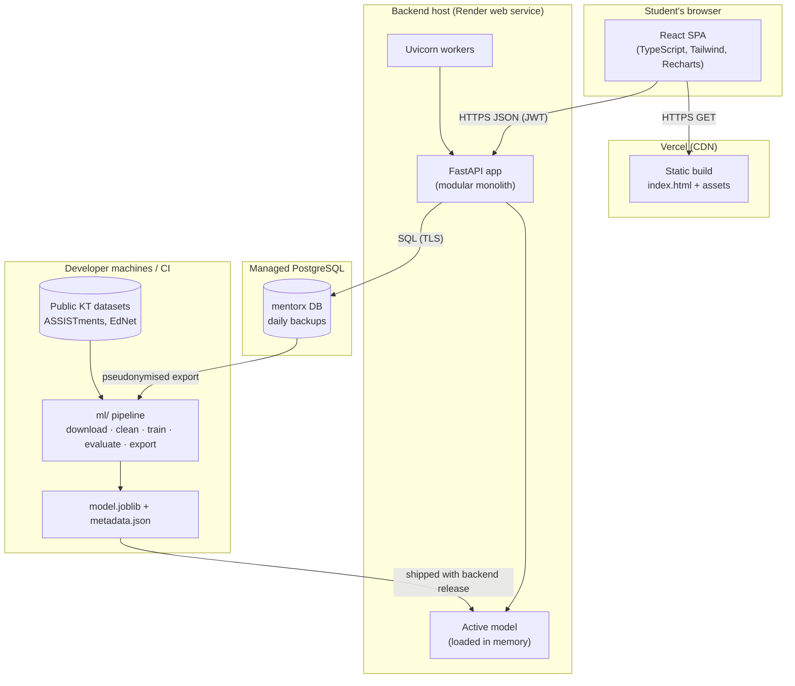
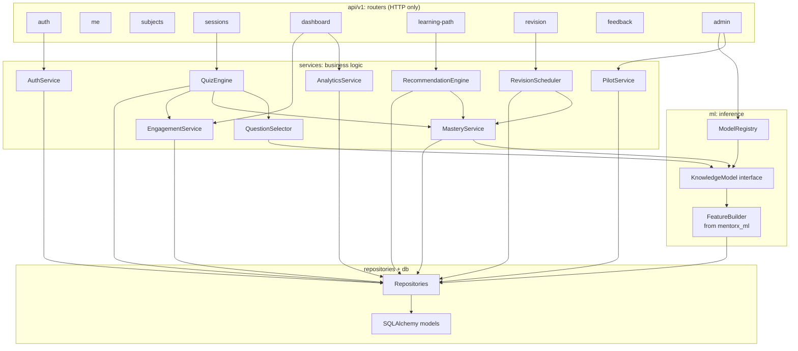

# System Architecture: MENTORX

## 1. Architectural style

A **modular monolith** backend with a layered structure, a separate single-page frontend, and an **offline** ML pipeline that produces versioned artifacts.

Why not microservices: one small team, one deployment, free-tier hosting, and modules that all need the same database transaction (e.g. submitting an answer writes an attempt, updates mastery and maybe regenerates the path). The modules communicate through Python interfaces, so the ML inference service could later move to its own process without changing callers.

## 2. Deployment view

The model artifact ships inside the backend release (it's small). `model_versions` in the database records which artifact is active, so switching between already-shipped versions needs no redeploy.

## 3. Component view (backend)

### Module responsibilities

| Module | Responsibility | Must not |
|---|---|---|
| Routers | Parse/validate requests (Pydantic), call one service, shape responses, map domain errors to HTTP codes | Contain SQL or business rules |
| AuthService | Register, verify passwords (Argon2id), issue/rotate/revoke tokens, rate limiting | Know about quizzes |
| QuizEngine | Session lifecycle; serve → answer → feedback loop; the transaction boundary for an answer | Choose questions itself (delegates) |
| QuestionSelector | Build candidate set, apply exclusions, rank by predicted p vs target (adaptive) or random (control) | Write to the DB |
| MasteryService | Recompute and store mastery + snapshot after an attempt; recompute stale mastery on read | Decide what's recommended |
| RecommendationEngine | Generate learning paths from mastery + prerequisite DAG | Call the model directly (uses MasteryService) |
| RevisionScheduler | Compute due concepts; project revision dates | — |
| AnalyticsService | Dashboard aggregates, trends, history | Return anything not derived from stored data |
| EngagementService | Valid-answer rules, daily goal, streaks, weekly report | — |
| PilotService | Group assignment, test forms, pilot metrics, pseudonymised export | Expose PII |
| ModelRegistry | Load the active artifact, verify its hash and feature list; fall back to the logistic-regression artifact, then to the constant prior (FR-KT-06) | — |
| KnowledgeModel | `predict(history, question, at_time) -> float` for GBM/LR/BKT/prior implementations | — |
| FeatureBuilder | Turn an attempt history into features using only past data. **Same code as training.** | Read future rows |

### Key design decisions

| # | Decision | Reason |
|---|---|---|
| D-1 | Modular monolith | Team size, single transaction per answer, free hosting |
| D-2 | `KnowledgeModel` interface with swappable implementations | Lets LR/GBM/BKT be compared and swapped; a logistic-regression fallback (then a constant prior) keeps the app working if the main artifact breaks |
| D-3 | Shared `mentorx_ml` package for features | Prevents train/serve skew, the most common bug in deployed ML |
| D-4 | Predictions stored before answers | Enables honest live evaluation of the model on real users |
| D-5 | Server holds the served-question state | Prevents cheating (no answer key on the client) and makes response time trustworthy |
| D-6 | Mastery = model prediction on a reference item *now* | Mastery decays naturally with time-since-practice, which drives revision with no separate forgetting model |
| D-7 | Content in YAML in git | Peer review via PRs, history, reproducible seeding |
| D-8 | Short-lived access JWT + rotating refresh cookie | Stateless request auth with real logout/revocation |
| D-9 | Random top-3 among closest-to-target | Avoids always serving the same question, adds exploration data for retraining |

## 4. API overview

All endpoints are under `/api/v1`, JSON, documented at `/docs`. 🔒 = needs an access token; 🛡 = admin only.

| Method | Path | Purpose | Req. |
|---|---|---|---|
| GET | `/health`, `/health/ready` | Liveness / readiness | NFR-OBS |
| POST | `/auth/register` | Create account | FR-AUTH-01 |
| POST | `/auth/login` | Get tokens | FR-AUTH-04 |
| POST | `/auth/refresh` | Rotate refresh token, new access token | FR-AUTH-05 |
| POST | `/auth/logout` | Revoke refresh token | FR-AUTH-05 |
| GET / PATCH | `/me` 🔒 | Read/update profile, goal, consent | FR-AUTH-08/09 |
| GET | `/me/export` 🔒 | Download my data | FR-AUTH-10 |
| DELETE | `/me` 🔒 | Delete account | FR-AUTH-11 |
| GET | `/subjects` 🔒 | List subjects | FR-CONT-01 |
| POST | `/subjects/{code}/enroll` 🔒 | Enrol | FR-CONT-02 |
| GET | `/subjects/{code}/concepts` 🔒 | Concepts, prerequisite graph, my mastery | FR-DASH-02 |
| POST | `/sessions` 🔒 | Start (or resume) a session `{subject, type, concept?}` | FR-QUIZ-01 |
| GET | `/sessions/{id}` 🔒 | Session state | FR-DIAG-06 |
| POST | `/sessions/{id}/next` 🔒 | Serve the next question (no answer key) | FR-QUIZ-02 |
| POST | `/sessions/{id}/answer` 🔒 | Submit `{question_id, selected_key \| null}` → feedback + mastery | FR-QUIZ-07/08 |
| POST | `/sessions/{id}/end` 🔒 | End session | FR-QUIZ-09 |
| GET | `/sessions` 🔒 | History | FR-DASH-05 |
| POST | `/questions/{id}/flag` 🔒 | Report a question | FR-QUIZ-11 |
| GET | `/learning-path?subject=` 🔒 | Current path | FR-PATH-01 |
| GET | `/revision?subject=` 🔒 | Revision queue | FR-REV-02 |
| GET | `/dashboard?subject=` 🔒 | Summary, strong/weak, streak, today | FR-DASH-01/03, FR-ENG-03 |
| GET | `/dashboard/trends?subject=&days=30` 🔒 | Accuracy + mastery series | FR-DASH-04 |
| GET | `/dashboard/activity?weeks=12` 🔒 | Heatmap data | FR-DASH-07 |
| POST | `/feedback` 🔒 | Submit feedback | FR-PILOT-03 |
| GET | `/admin/pilot/metrics` 🛡 | Pilot dashboard | FR-DASH-09 |
| GET | `/admin/export/attempts` 🛡 | Pseudonymised export | FR-PILOT-05 |
| GET / POST | `/admin/models`, `/admin/models/{id}/activate` 🛡 | Model versions | FR-KT-05 |

**Errors** use one shape: `{"error": {"code": "session_question_mismatch", "message": "...", "request_id": "..."}}`. HTTP codes: 400 validation, 401 unauthenticated, 403 forbidden, 404 not found / not yours (no ownership disclosure), 409 state conflict, 429 rate limited, 503 dependency down.

## 5. Security architecture

| Threat | Control |
|---|---|
| Credential stuffing / brute force | Rate limits per IP + email; Argon2id; generic errors |
| Token theft | 30-min access tokens; refresh in HttpOnly + Secure + SameSite=Strict cookie, path-scoped; rotation with reuse detection |
| Cheating (answer key) | Key never sent before answering; answers only accepted for the served question |
| IDOR (reading others' data) | Every repository query filters by the authenticated `user_id`; per-endpoint authorization tests |
| Injection | Pydantic validation; ORM-parameterised queries only |
| XSS | React escaping; question markdown rendered with a sanitiser; strict CSP on Vercel |
| CSRF | Access token in header (not cookie); refresh endpoint is SameSite=Strict + origin check |
| Secrets leakage | Env vars only; `.env` gitignored; CI secret scanning |
| PII in ML data | Pseudonymised export with secret salt; consent-only |

## 6. Configuration

All settings come from environment variables (`pydantic-settings`), with `.env.example` documenting each one. Tunable product thresholds (target p, mastery thresholds, session lengths, exclusion window, valid-answer minimum) live in one `LearningConfig` object, so experiments change config, not code.
