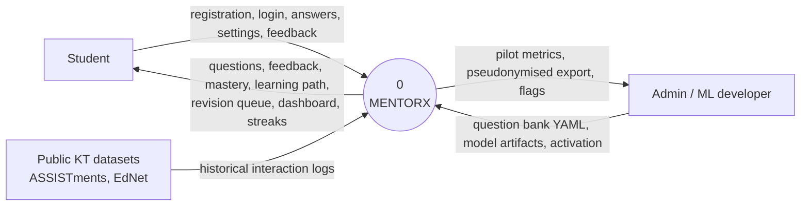
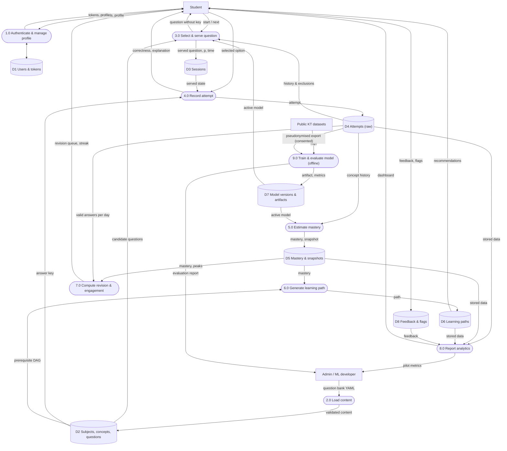
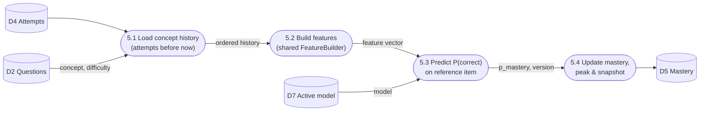

# Data Flow Diagrams: MENTORX

Notation (Gane–Sarson style, drawn with Mermaid): rectangles = external entities, rounded boxes = processes, cylinders = data stores, arrows = data flows.

## Level 0: context diagram

## Level 1

## Level 2: 5.0 Estimate mastery

## Data dictionary (key flows)

| Flow | Contents |
|---|---|
| answers | `session_id, question_id, selected_key \| null` |
| served question | `question_id, stem, options (A–D)`, no key or explanation |
| attempt | `user, session, question, selected_key, is_correct, response_ms, attempt_no, is_valid, predicted_p, model_version, created_at` |
| concept history | ordered attempts of one user on one concept: `is_correct, created_at, question difficulty, attempt_no` |
| feature vector | prior attempts/correct on concept, smoothed accuracy, last-k correctness, log time since last (concept/any), overall accuracy, question difficulty, attempt_no |
| pseudonymised export | `sha256(user_id + salt), question external_id, concept code, difficulty, is_correct, response_ms, attempt_no, created_at` |
