# Database Design: MENTORX

PostgreSQL 16+, managed by SQLAlchemy 2.x models and Alembic migrations. **This document is the authoritative schema.** Where it differs from §4 of the project plan, this version wins (it adds the fields that the use cases turned out to need).

Design principles:
1. **Raw vs derived.** `attempts` is append-only truth. `mastery`, `mastery_snapshots` and `learning_paths` are derived and can be rebuilt from attempts with a command (NFR-REL-01).
2. **Server-side trust.** Correct answers, served-question state, response time and predictions live on the server; the client only sends "I chose B" (FR-CONT-08, FR-QUIZ-05/06/07).
3. **Everything versioned that can change**: question versions, model versions, path history.
4. **Delete cascades from users** so account deletion is a single delete (FR-AUTH-11).

## 1. ER diagram

```mermaid
erDiagram
  USERS ||--o{ ENROLLMENTS : "enrols in"
  SUBJECTS ||--o{ ENROLLMENTS : "has"
  SUBJECTS ||--|{ CONCEPTS : "contains"
  CONCEPTS ||--o{ CONCEPT_PREREQUISITES : "depends on"
  CONCEPTS ||--o{ CONCEPT_PREREQUISITES : "is prerequisite of"
  CONCEPTS ||--o{ QUESTIONS : "tested by"
  USERS ||--o{ REFRESH_TOKENS : "holds"
  USERS ||--o{ STUDY_SESSIONS : "starts"
  SUBJECTS ||--o{ STUDY_SESSIONS : "for"
  STUDY_SESSIONS ||--o{ ATTEMPTS : "contains"
  USERS ||--o{ ATTEMPTS : "makes"
  QUESTIONS ||--o{ ATTEMPTS : "answered in"
  MODEL_VERSIONS ||--o{ ATTEMPTS : "predicted"
  USERS ||--o{ MASTERY : "has"
  CONCEPTS ||--o{ MASTERY : "estimated for"
  MODEL_VERSIONS ||--o{ MASTERY : "produced"
  USERS ||--o{ MASTERY_SNAPSHOTS : "has"
  CONCEPTS ||--o{ MASTERY_SNAPSHOTS : "for"
  USERS ||--o{ LEARNING_PATHS : "has"
  SUBJECTS ||--o{ LEARNING_PATHS : "for"
  LEARNING_PATHS ||--|{ LEARNING_PATH_ITEMS : "lists"
  CONCEPTS ||--o{ LEARNING_PATH_ITEMS : "recommended"
  USERS ||--o{ FEEDBACK : "gives"
  USERS ||--o{ QUESTION_FLAGS : "raises"
  QUESTIONS ||--o{ QUESTION_FLAGS : "flagged"

  USERS {
    uuid id PK
    citext email UK
    text password_hash
    varchar full_name
    varchar role "student | admin"
    boolean consent_research
    timestamptz privacy_accepted_at
    smallint daily_goal "1-100"
    varchar timezone
    varchar experiment_group "adaptive | control | null"
    varchar pretest_form "A | B | null"
    timestamptz created_at
    timestamptz updated_at
  }
  REFRESH_TOKENS {
    uuid id PK
    uuid user_id FK
    char token_hash UK "sha256"
    timestamptz expires_at
    timestamptz revoked_at
    uuid replaced_by_id FK
    timestamptz created_at
  }
  SUBJECTS {
    int id PK
    varchar code UK
    varchar name
    text description
    boolean is_active
  }
  ENROLLMENTS {
    uuid user_id PK, FK
    int subject_id PK, FK
    timestamptz enrolled_at
    timestamptz diagnostic_completed_at
  }
  CONCEPTS {
    int id PK
    int subject_id FK
    varchar code UK
    varchar name
    text description
    smallint topo_order
  }
  CONCEPT_PREREQUISITES {
    int concept_id PK, FK
    int prerequisite_id PK, FK
  }
  QUESTIONS {
    int id PK
    varchar external_id "id in YAML"
    smallint version
    int concept_id FK
    text stem
    jsonb options
    char correct_key
    text explanation
    smallint author_difficulty "1-3"
    real est_difficulty
    boolean is_diagnostic
    varchar test_form "A | B | null"
    varchar status "active | retired"
    timestamptz created_at
  }
  STUDY_SESSIONS {
    uuid id PK
    uuid user_id FK
    int subject_id FK
    varchar type "diagnostic|practice|revision|pretest|posttest|challenge"
    int focus_concept_id FK
    varchar status "active | completed | abandoned"
    smallint target_count
    smallint answered_count
    int current_question_id FK
    timestamptz current_served_at
    real current_predicted_p
    int current_model_version_id FK
    timestamptz started_at
    timestamptz ended_at
  }
  ATTEMPTS {
    bigint id PK
    uuid user_id FK
    uuid session_id FK
    int question_id FK
    char selected_key "null = I don't know"
    boolean is_correct
    int response_ms
    smallint attempt_no
    boolean is_valid "counts for streaks"
    real predicted_p_correct
    int model_version_id FK
    timestamptz created_at
  }
  MASTERY {
    uuid user_id PK, FK
    int concept_id PK, FK
    real p_mastery
    real peak_mastery
    int n_attempts
    timestamptz last_attempt_at
    int model_version_id FK
    timestamptz updated_at
  }
  MASTERY_SNAPSHOTS {
    bigint id PK
    uuid user_id FK
    int concept_id FK
    real p_mastery
    bigint attempt_id FK
    timestamptz created_at
  }
  LEARNING_PATHS {
    uuid id PK
    uuid user_id FK
    int subject_id FK
    boolean is_current
    varchar trigger "diagnostic|session|revision|manual"
    int model_version_id FK
    timestamptz generated_at
  }
  LEARNING_PATH_ITEMS {
    uuid path_id PK, FK
    smallint position PK
    int concept_id FK
    varchar reason "weak|prerequisite|revision|new"
    smallint target_difficulty
    real mastery_at_generation
    text explanation
  }
  MODEL_VERSIONS {
    int id PK
    varchar name UK
    varchar model_type "logreg|gbm|bkt|heuristic"
    varchar artifact_path
    char artifact_sha256
    jsonb feature_names
    jsonb metrics
    varchar training_data
    boolean is_active
    timestamptz trained_at
    timestamptz created_at
  }
  FEEDBACK {
    bigint id PK
    uuid user_id FK
    smallint rating "1-5"
    varchar category
    text message
    varchar page
    timestamptz created_at
  }
  QUESTION_FLAGS {
    bigint id PK
    uuid user_id FK
    int question_id FK
    text comment
    varchar status "open | resolved"
    timestamptz created_at
  }
```



## 2. Table notes, constraints and indexes

### users
- `email` uses `CITEXT` (extension `citext`) so uniqueness is case-insensitive (FR-AUTH-02).
- CHECK `role IN ('student','admin')`, `daily_goal BETWEEN 1 AND 100`, `experiment_group IN ('adaptive','control')` or NULL.
- `privacy_accepted_at NOT NULL`: registration fails without it (FR-AUTH-01). `consent_research` defaults to `false` (FR-AUTH-09).

### refresh_tokens
- Only the SHA-256 hash of the token is stored, so a database leak doesn't expose usable tokens.
- Rotation: on refresh, the old row gets `revoked_at` and `replaced_by_id`. If a revoked token is presented again, all of that user's tokens are revoked (reuse detection).
- Index `(user_id)`; `ON DELETE CASCADE` from users.

### subjects / concepts / concept_prerequisites
- `concepts.code` is globally unique (e.g. `ml.regularization`). `topo_order` is computed by the seed command.
- CHECK `concept_id <> prerequisite_id`. Acyclicity is enforced by the seed validator (`app/content/question_bank.py`), since a CHECK can't express it.
- Both FKs on `concept_prerequisites` are `ON DELETE CASCADE`.

### questions
- UNIQUE `(external_id, version)`. Only one version per `external_id` may be `active`: partial unique index `ON questions(external_id) WHERE status = 'active'`.
- CHECK `author_difficulty BETWEEN 1 AND 3`, `correct_key IN ('A','B','C','D')`, `jsonb_array_length(options) = 4`.
- `test_form` marks pre/post-test questions (forms A and B). These are excluded from practice so test results aren't contaminated.
- Index `(concept_id, status)`, `(is_diagnostic) WHERE status='active'`.
- Never deleted, only retired (attempts reference them).

### study_sessions
- The `current_*` columns hold the one served-but-unanswered question. Submitting an answer checks `question_id = current_question_id` (FR-QUIZ-07), computes `response_ms = now() - current_served_at` (FR-QUIZ-06), copies `current_predicted_p` and `current_model_version_id` into the attempt (FR-QUIZ-05), then clears them. This happens in **one transaction** with `SELECT … FOR UPDATE` on the session row, so a double-submit can't create two attempts.
- Partial unique index: one `active` session per `(user_id, subject_id, type)`, which makes resuming deterministic (FR-DIAG-06).
- Index `(user_id, started_at DESC)`.

### attempts
- Append-only. The application role has no UPDATE privilege on this table in production; DELETE only happens via cascade from users.
- `attempt_no` = how many times this user has now answered this question (1 for the first).
- `is_valid` = `response_ms ≥ 3000` and not part of a rapid-guess run (FR-ENG-02). It's stored so streak queries stay simple.
- Indexes: `(user_id, created_at)`, `(user_id, question_id)`, `(session_id)`, `(question_id)`.

### mastery
- One row per (user, concept). `peak_mastery = max(peak_mastery, p_mastery)`, which the revision rule needs (FR-REV-01).
- CHECK `p_mastery BETWEEN 0 AND 1`.

### mastery_snapshots
- One row per mastery update; powers trend charts (FR-DASH-04) and before/after revision (FR-REV-04).
- Index `(user_id, concept_id, created_at)`.

### learning_paths / learning_path_items
- Partial unique index: one `is_current = true` path per `(user_id, subject_id)`.
- Old paths are kept (FR-PATH-05) so recommendation effectiveness can be measured: did mastery on recommended concepts improve more than on others?

### model_versions
- Partial unique index: only one row with `is_active = true` (FR-KT-05).
- `metrics` copies the evaluation report's headline numbers; `artifact_sha256` guards against loading a different file than the one evaluated.
- A built-in row `heuristic` exists for the fallback (FR-KT-06).

## 3. Key queries (and the index that serves each)

| Query | Index |
|---|---|
| Student's attempts on a concept, in time order (feature building) | `attempts(user_id, created_at)` + join `questions(concept_id)` |
| Eligible candidate questions for a concept | `questions(concept_id, status)` |
| Questions this user answered correctly in the last 7 days | `attempts(user_id, question_id)` |
| Active session for a user | partial unique on `study_sessions` |
| Dashboard mastery | PK `mastery(user_id, concept_id)` |
| Trend chart | `mastery_snapshots(user_id, concept_id, created_at)` |
| Valid answers per local day (streak) | `attempts(user_id, created_at)` |

## 4. Pseudonymised training export (FR-PILOT-05, NFR-PRIV-02)

```sql
SELECT encode(digest(a.user_id::text || :salt, 'sha256'), 'hex') AS student_id,
       q.external_id AS question_id, c.code AS concept, q.author_difficulty,
       a.is_correct, a.response_ms, a.attempt_no, a.created_at
FROM attempts a
JOIN users u     ON u.id = a.user_id AND u.consent_research
JOIN questions q ON q.id = a.question_id
JOIN concepts c  ON c.id = q.concept_id
ORDER BY student_id, a.created_at;
```
The salt is an environment secret, so hashes can't be reversed by guessing user IDs. The `pgcrypto` extension provides `digest`.
