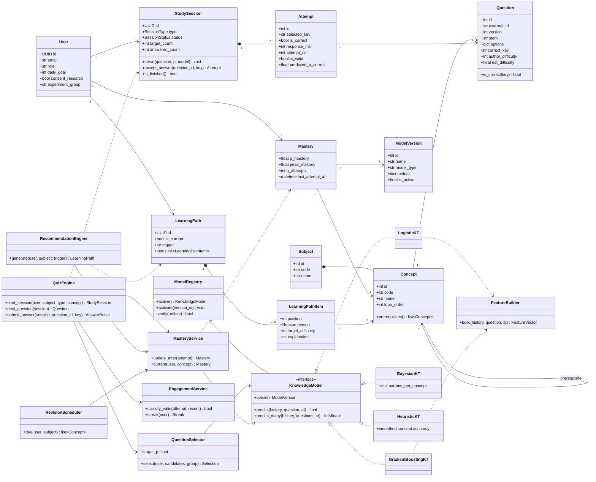
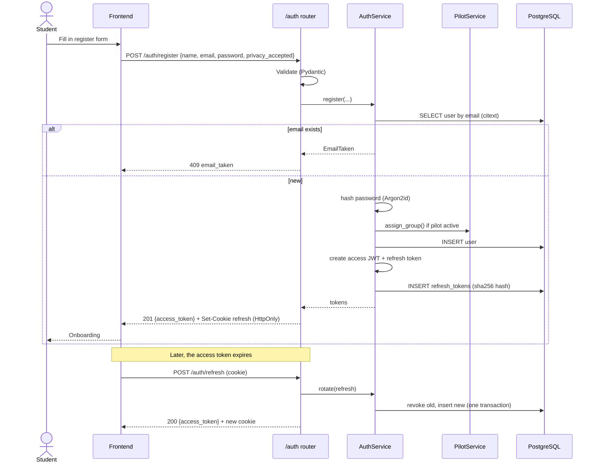
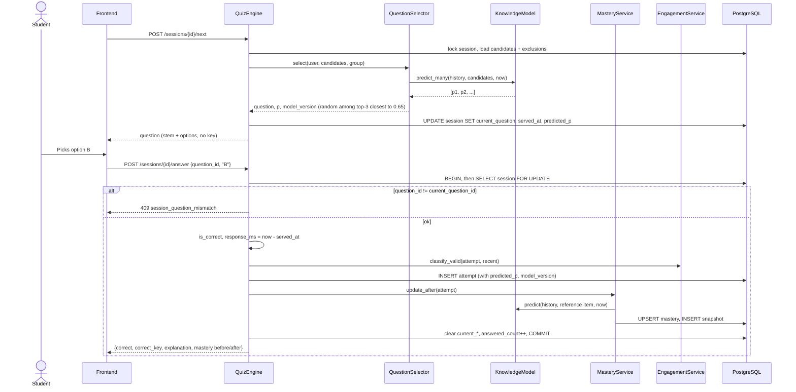
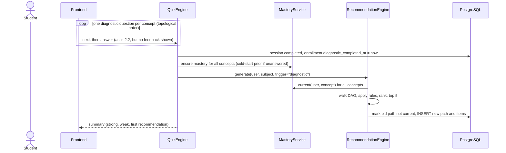
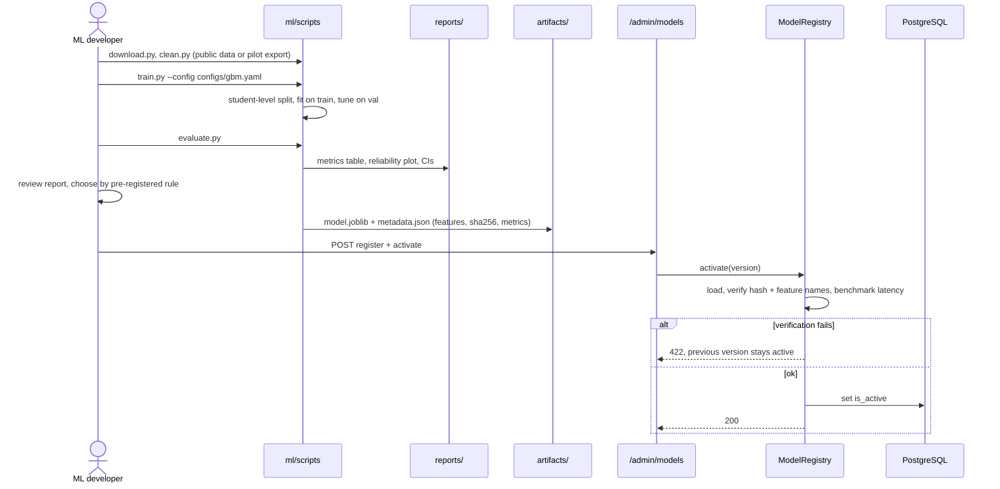
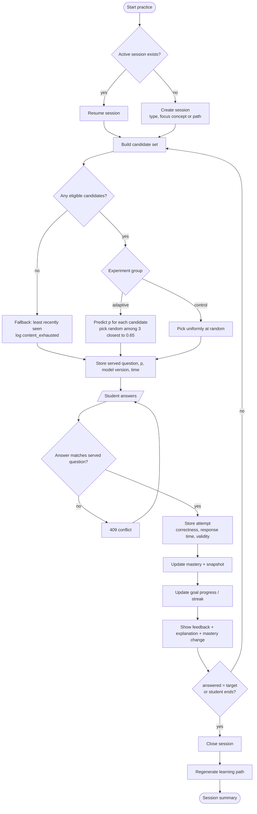
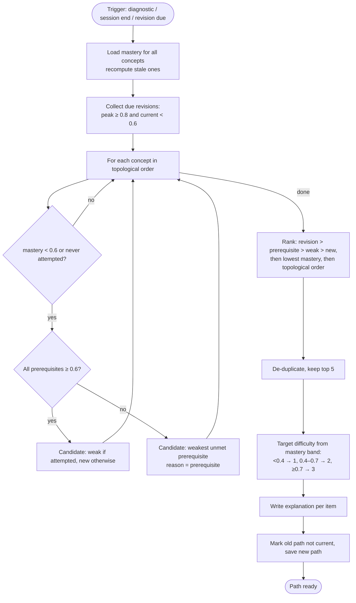
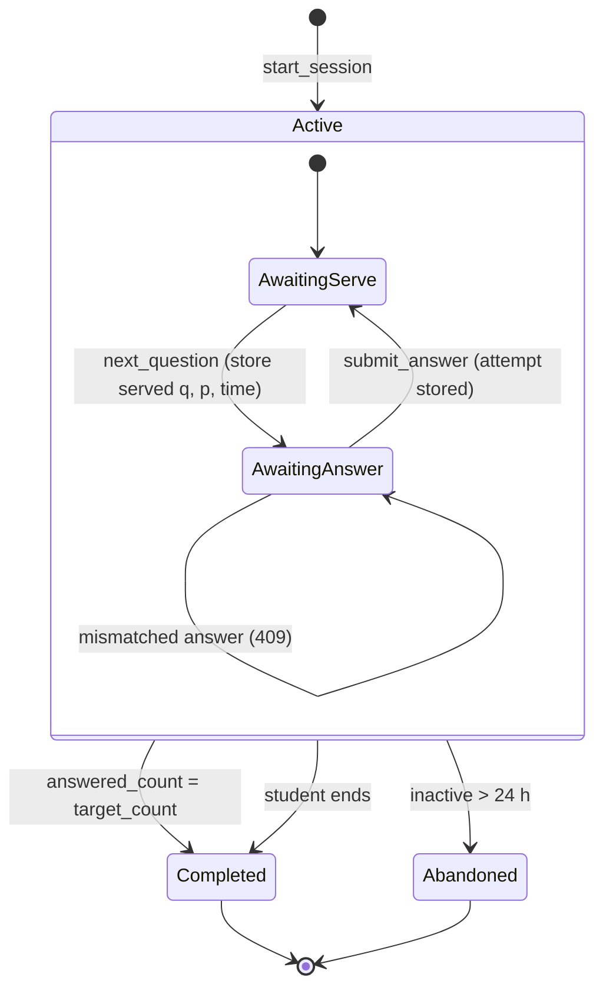

# UML Diagrams: MENTORX

Contents: [Class diagram](#1-class-diagram) · [Sequence diagrams](#2-sequence-diagrams) · [Activity diagrams](#3-activity-diagrams) · [State diagram](#4-state-diagram-study-session). The use case diagram is in [use-cases.md](../srs/use-cases.md); the ER diagram is in [database.md](database.md).

## 1. Class diagram

Domain entities (persisted) on the left, services and ML classes on the right. Attributes are abbreviated; the full columns are in the ER diagram.

## 2. Sequence diagrams

### 2.1 Register and log in

### 2.2 Answer a question (adaptive practice)

### 2.3 Complete the diagnostic and generate the first path

### 2.4 Train, register and activate a model (offline)

## 3. Activity diagrams

### 3.1 Practice session

### 3.2 Learning path generation

## 4. State diagram: study session

