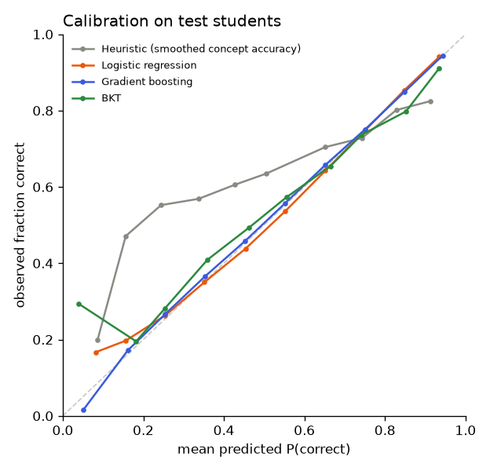
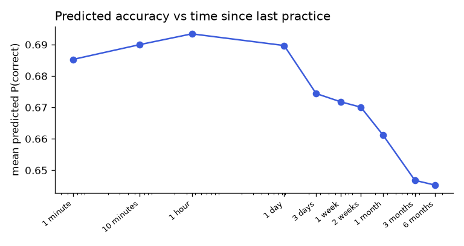

# ML Report: Knowledge Tracing for MENTORX (M4)

**Question:** Given a student's answer history, how well can we predict whether they'll answer the next question correctly? Which model should MENTORX use to choose questions, estimate mastery and schedule revision?

Every number below comes from a generated report (linked) and can be reproduced with the commands in §8. No result was typed by hand.

## 1. Data

| Dataset | Answers | Students | Items | Concepts | Correct rate | Timestamps | Details |
|---|---:|---:|---:|---:|---:|---|---|
| ASSISTments 2009 (school maths) | 259,132 | 4,160 | 15,920 | 145 | 65.8% | No (order only) | [EDA](../ml/reports/eda/assist2009/report.md) |
| EdNet-KT1 sample (TOEIC English, MCQ) | 1,144,108 | 10,000 | 12,090 | 1,779 | 65.3% | Yes | [EDA](../ml/reports/eda/ednet/report.md) |

Sources, licences, checksums and cleaning rules: [datasets.md](datasets.md).

## 2. Method

**Task.** For each answer, predict P(correct) using only information available *before* the answer.

**Features** (all concept-agnostic, so they transfer to MENTORX's questions; [`features.py`](../ml/mentorx_ml/features.py)):
- *History* (the student's own earlier answers only): attempts and smoothed accuracy on the concept, accuracy over the last 3 attempts on it, previous outcome on it, whether it's a first attempt, interactions since it was last practised, overall accuracy and last-10 accuracy, previous attempts at the same item.
- *Time* (EdNet only): log seconds since the concept was last practised, and since the previous answer.
- *Difficulty*: smoothed item and concept correct rates learned **from training students only**. For training rows they're cross-fitted (5 student folds), so a row's own label never feeds its feature.

**Models**:
- **Prior**: the constant training average.
- **Heuristic**: smoothed concept accuracy, with no training.
- **Logistic regression**: standardised features, C tuned.
- **Gradient boosting**: scikit-learn HistGradientBoosting (the LightGBM algorithm), learning rate and tree size tuned.
- **BKT**: per-concept 4-parameter Bayesian Knowledge Tracing, implemented from scratch ([`bkt.py`](../ml/mentorx_ml/bkt.py)) and fitted by maximum likelihood. A test confirms it recovers known parameters from simulated students.

**Validation protocol** (prevents leakage and test-set overfitting):
1. Split **by student**, 70/15/15 (seed 42). No student appears in two splits.
2. All tuning and the model choice use validation students only.
3. **Pre-registered selection rule**, written in the config before any run: lowest validation log loss among models with ECE ≤ 0.05 that score 50 candidates in ≤ 50 ms.
4. Test students are scored once by `evaluate.py`, which refuses to re-run without `--force` and logs every access.
5. 95% confidence intervals come from bootstrapping whole students (200 reps). Model differences use paired bootstraps.

**Metrics:** AUC (ranking), log loss (probability quality, the selection metric), accuracy, F1, Brier score, and expected calibration error. Calibration matters because MENTORX acts on the probabilities directly, for example by targeting P(correct) ≈ 0.65.

Leakage is guarded by tests: changing a row's label, or any later label, leaves its features unchanged; other students' labels never affect a student's history features; and cross-fitted difficulty ignores a row's own label ([`test_features.py`](../ml/tests/test_features.py)).

## 3. Results on held-out test students

### ASSISTments 2009 ([full report](../ml/reports/models/assist2009/report.md))
| Model | AUC (95% CI) | Log loss (95% CI) | ECE |
|---|---|---|---:|
| **Gradient boosting** ⭐ | **0.775** (0.762–0.785) | **0.523** (0.513–0.534) | 0.004 |
| Logistic regression | 0.761 (0.748–0.772) | 0.535 (0.525–0.546) | 0.011 |
| BKT | 0.716 (0.703–0.727) | 0.569 (0.558–0.580) | 0.013 |
| Heuristic | 0.681 (0.664–0.695) | 0.623 (0.614–0.630) | 0.120 |
| Prior | 0.500 | 0.639 (0.627–0.650) | 0.012 |

### EdNet ([full report](../ml/reports/models/ednet/report.md))
| Model | AUC (95% CI) | Log loss (95% CI) | ECE |
|---|---|---|---:|
| **Gradient boosting** ⭐ | **0.771** (0.763–0.780) | **0.532** (0.518–0.546) | 0.004 |
| Logistic regression | 0.752 (0.744–0.759) | 0.551 (0.536–0.565) | 0.009 |
| BKT | 0.642 (0.633–0.653) | 0.616 (0.601–0.631) | 0.019 |
| Prior | 0.500 | 0.645 (0.633–0.657) | 0.006 |
| Heuristic | 0.566 (0.551–0.581) | 0.675 (0.663–0.685) | 0.117 |

Gradient boosting was selected on validation data on both datasets and is also best on test. Its paired improvement over the heuristic is clear of zero (full reports). Against logistic regression the gap is smaller (0.014 AUC on ASSISTments, 0.019 on EdNet) and the unpaired intervals overlap slightly, so the honest claim is "consistently better on both datasets", not "significantly better".



## 4. Ablations: what drives the predictions ([report](../ml/reports/models/ablations.md))

| Question | Comparison (gradient boosting, paired on the same test students) | Δ AUC (95% CI) |
|---|---|---|
| How much does per-question difficulty matter? | ASSISTments without item difficulty | −0.029 (−0.035 to −0.025) |
| … and all difficulty features? | ASSISTments, history features only | −0.057 (−0.064 to −0.050) |
| Does elapsed time matter? | EdNet without the 2 time features | −0.009 (−0.012 to −0.007) |

The most important single feature on both datasets is the question's own difficulty (`item_logit`), followed by the student's overall accuracy (permutation importance in the full reports).

## 5. Does the model learn forgetting? ([report](../ml/reports/models/ednet/time_response.md))

Holding every other feature fixed and varying only the time since the concept was last practised, the EdNet model's mean predicted accuracy **peaks at 0.693 one hour after practice and falls to 0.645 after six months**.



This is the behaviour MENTORX's revision scheduler depends on (FR-REV-01): mastery estimates decline without practice. *Caveat:* this is observational data, not a controlled forgetting experiment.

## 6. Decisions for MENTORX

| Decision | Choice | Evidence |
|---|---|---|
| Model family | **Gradient boosting** | Best on both datasets, well calibrated (ECE 0.004), scores 50 candidates in a few ms |
| Training data for v1 | **EdNet** | Multiple-choice format like MENTORX, has timestamps (needed for decay/revision), 4× more data |
| Feature set | History + time + difficulty | Each group adds measurable, significant value (§4) |
| Question difficulty at launch | Smoothed estimate whose prior comes from the author's 1–3 rating, updated as answers arrive | MENTORX's questions have no history at launch; §4 shows this costs about 0.03 AUC at first, recovered as data accrues |
| Fallback (FR-KT-06, **changed**) | Logistic regression, then constant prior | The planned heuristic is badly calibrated (ECE ≈ 0.12) and on EdNet worse than the constant prior |
| BKT | Kept as an interpretable baseline, not deployed | Clearly worse than the feature models, especially with EdNet's many small tag-set concepts |

The v1 artifact (EdNet gradient boosting) is exported and integrated with the backend in M6. That milestone adds a fast serving path for the features, tested to produce identical values to the training code (design decision D-3).

## 7. Limitations (state these in the report and viva)

1. **Domain transfer is unproven.** Both datasets differ from undergraduate ML (school maths; English test prep). The reported numbers describe those datasets, not MENTORX. MENTORX logs every prediction before the answer (FR-QUIZ-05), so live AUC and calibration on real students will be measured during the pilot (M11).
2. **Cold-start difficulty.** The strongest feature is unavailable for new questions; the author-rating prior is a guess until data accumulates.
3. **No DKT.** Deep Knowledge Tracing (a "Could" requirement) wasn't run. Published DKT results on ASSISTments 2009 typically use all rows, including scaffolding, so they aren't directly comparable with these numbers.
4. **One random split per dataset.** The CIs capture variation among test students, not variation across different splits.
5. **EdNet sample.** 10,000 of 784,309 students. Larger samples might change the absolute numbers somewhat.

## 8. Reproduce

From `ml/` (Python 3.11+, `pip install -e ".[dev]"`):

```bash
python scripts/download.py --dataset assist2009      # and: --dataset ednet (1.2 GB)
python scripts/clean.py    --dataset assist2009      # and: --dataset ednet
python scripts/eda.py      --dataset assist2009      # and: --dataset ednet
for c in assist2009 assist2009_no_item_difficulty assist2009_history_only ednet ednet_no_time; do
  python scripts/train.py    --config configs/$c.yaml
  python scripts/evaluate.py --config configs/$c.yaml
done
python scripts/compare.py --out reports/models/ablations.md \
  --group "ASSISTments 2009: how much does question difficulty matter?" configs/assist2009.yaml configs/assist2009_no_item_difficulty.yaml configs/assist2009_history_only.yaml \
  --group "EdNet: how much does elapsed time matter?" configs/ednet.yaml configs/ednet_no_time.yaml
python scripts/time_response.py --config configs/ednet.yaml
```

Total runtime on a laptop: about 10 minutes, plus the EdNet download.
