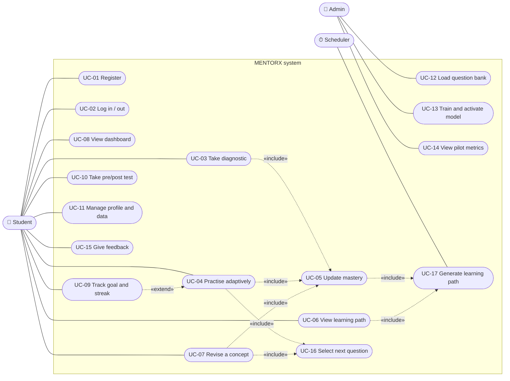

# Use Cases: MENTORX

## 1. Use case diagram

Mermaid has no native UML use-case notation. Actors are drawn as person-shaped nodes, use cases as ovals inside the system boundary, and `«include»` / `«extend»` are labelled edges.

## 2. Use case descriptions

### UC-01 Register
| | |
|---|---|
| Actor | Visitor (becomes Student) |
| Precondition | Not logged in |
| Trigger | Visitor clicks "Get started" |
| Main flow | 1. Visitor enters name, email, password and accepts the privacy notice. 2. System validates the input. 3. System hashes the password and creates the user. 4. If the pilot is active, system assigns an experiment group at random. 5. System issues tokens and opens onboarding. |
| Alternatives | 2a. Invalid input → field errors shown, nothing saved. 3a. Email exists → error, nothing saved. |
| Postcondition | User exists and is authenticated |
| Requirements | FR-AUTH-01/02/03, FR-PILOT-01 |

### UC-02 Log in / log out
| | |
|---|---|
| Actor | Student |
| Main flow | 1. Student enters email and password. 2. System verifies the hash. 3. System issues an access token and a rotating refresh cookie. 4. Dashboard opens. Log out: system revokes the refresh token and clears the cookie. |
| Alternatives | 2a. Wrong credentials → generic error. 2b. Rate limit exceeded → "Try again in a minute". |
| Requirements | FR-AUTH-04/05/06/07 |

### UC-03 Take diagnostic
| | |
|---|---|
| Actor | Student |
| Precondition | Enrolled in subject, diagnostic not completed |
| Main flow | 1. Student starts the diagnostic. 2. System creates a `diagnostic` session. 3. System serves the next diagnostic question in topological concept order. 4. Student answers or picks "I don't know yet". 5. System records the attempt (**includes UC-05**). 6. Repeat 3–5 for every concept. 7. System marks the diagnostic complete, generates the learning path (UC-17) and shows a summary. |
| Alternatives | 4a. Student leaves → session stays open; resumes at step 3. 1a. Student skips → mastery uses cold-start prior; path generated from it. |
| Postcondition | Mastery exists for every concept; first learning path exists |
| Requirements | FR-DIAG-01…06 |

### UC-04 Practise adaptively
| | |
|---|---|
| Actor | Student |
| Precondition | Logged in and enrolled |
| Main flow | 1. Student starts recommended or concept practice. 2. System creates a `practice` session. 3. System selects the next question (**includes UC-16**) and stores the served question, predicted p, model version and served time. 4. Student answers. 5. System validates that the answer is for the served question, computes correctness and response time, and stores the attempt. 6. System updates mastery (**includes UC-05**). 7. System returns feedback and the new mastery. 8. Repeat 3–7 until 10 questions or student ends. 9. System closes the session and regenerates the path. |
| Alternatives | 3a. No eligible questions → least-recently-seen fallback, event logged. 5a. Answer for a stale/different question → 409 Conflict, nothing stored. |
| Extension | UC-09 updates goal progress and streak after valid answers |
| Requirements | FR-QUIZ-01…10, FR-KT-03 |

### UC-05 Update mastery
| | |
|---|---|
| Actor | System (triggered by UC-03/04/07) |
| Main flow | 1. Load the student's attempt history for the concept. 2. Build features with the shared feature builder. 3. Active model predicts P(correct) on a reference medium-difficulty item now. 4. Upsert `mastery` with the model version; append a `mastery_snapshots` row. |
| Alternatives | 3a. Primary model unavailable → logistic-regression fallback; if that's unavailable too → constant prior, flagged `model_version = prior` (FR-KT-06). |
| Requirements | FR-KT-01…06 |

### UC-06 View learning path
| | |
|---|---|
| Actor | Student |
| Main flow | 1. Student opens the dashboard or path page. 2. System returns the current path (**includes UC-17** if none exists or it's stale). 3. Each item shows concept, reason, target difficulty and explanation, with a "Practise" button. |
| Requirements | FR-PATH-01…06 |

### UC-07 Revise a concept
| | |
|---|---|
| Actor | Student |
| Precondition | At least one concept due for revision |
| Main flow | 1. Student opens the revision queue. 2. System lists due concepts ordered by mastery drop. 3. Student starts revision. 4. Same loop as UC-04 with 5 questions from due concepts. 5. System shows mastery before and after. |
| Requirements | FR-REV-01…04 |

### UC-08 View dashboard
| | |
|---|---|
| Actor | Student |
| Main flow | 1. Student opens the dashboard. 2. System returns summary, mastery per concept, strongest/weakest concepts, trends, history, path, revision queue and streak, all computed from stored data. 3. Frontend renders charts; empty states explain next steps. |
| Requirements | FR-DASH-01…08 |

### UC-09 Track goal and streak
| | |
|---|---|
| Actor | Student (extends UC-04) |
| Main flow | 1. After each valid answer, today's count increases. 2. When it reaches the goal, today counts toward the streak. 3. Dashboard shows the current streak, longest streak and today's progress. |
| Requirements | FR-ENG-01…03 |

### UC-10 Take pre/post test
| | |
|---|---|
| Actor | Pilot participant |
| Main flow | 1. At pilot start, system prompts the pre-test (form A or B, counterbalanced). 2. Student answers all questions without feedback. 3. At the end of the pilot window, system prompts the post-test with the other form. 4. After the post-test, the SUS survey is shown. |
| Requirements | FR-PILOT-01/02/04 |

### UC-11 Manage profile and data
| | |
|---|---|
| Actor | Student |
| Main flow | Edit name/goal/time zone; toggle research consent; export data as JSON; delete account (confirm by typing email → cascade delete → logout). |
| Requirements | FR-AUTH-08…11 |

### UC-12 Load question bank
| | |
|---|---|
| Actor | Admin |
| Main flow | 1. Admin merges reviewed YAML to `main`. 2. Admin (or the deploy hook) runs the seed command. 3. System validates the bank (schema, DAG, ids). 4. System upserts the subject and concepts, inserts new questions, versions changed ones and retires removed ones. 5. System prints a summary. |
| Alternatives | 3a. Validation fails → nothing written, errors printed, non-zero exit code. |
| Requirements | FR-CONT-03…07 |

### UC-13 Train and activate model
| | |
|---|---|
| Actor | Admin / ML developer |
| Main flow | 1. Run download → clean → train → evaluate scripts with a config. 2. Review the generated report. 3. Export the artifact + metadata. 4. Register it as a model version. 5. Activate it; the backend reloads the active model. |
| Alternatives | 5a. Artifact fails validation (feature mismatch, failed load, slow inference) → activation refused, previous version stays active. |
| Requirements | FR-KT-05/07/08, NFR-ML-01…04 |

### UC-14 View pilot metrics
| | |
|---|---|
| Actor | Admin |
| Main flow | Admin opens the pilot dashboard: WAU, retention, completion, pre/post gain by group with CIs, live AUC/calibration from stored predictions, and feedback. Admin can export pseudonymised data. |
| Requirements | FR-DASH-09, FR-PILOT-05 |

### UC-15 Give feedback
Student opens the feedback dialog from any page, gives a 1–5 rating, category and message; system stores it with the page URL. (FR-PILOT-03)

### UC-16 Select next question
System use case. Candidates = active questions for the session's target concepts, minus excluded ones (FR-QUIZ-03). Adaptive group: predict p for each candidate and pick randomly among the 3 closest to the target. Control group: pick uniformly at random. Store served question, p and model version on the session. (FR-QUIZ-02…05, FR-QUIZ-10)

### UC-17 Generate learning path
System use case, also triggered by the scheduler for due revisions. Walk the concept DAG in topological order; collect due revisions, weak concepts (mastery < 0.6) whose prerequisites are met, unmet prerequisites of weak concepts, and new concepts; rank and keep up to 5; mark the previous path not current; store the new one. (FR-PATH-01…05)
