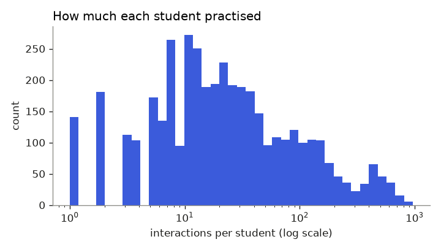
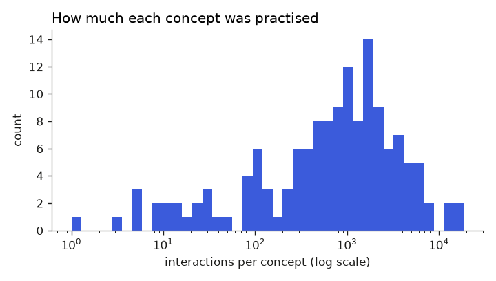
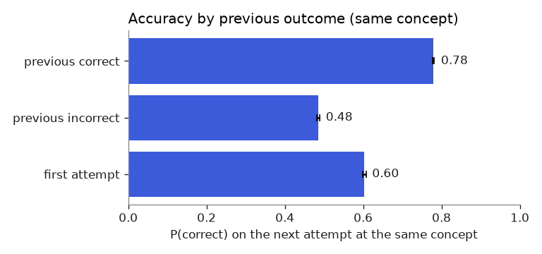
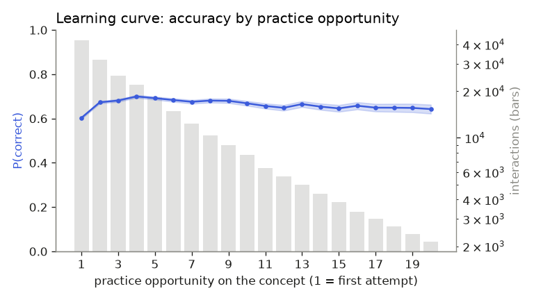
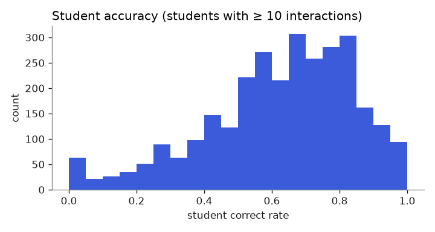
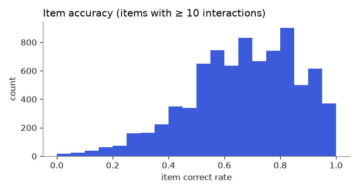
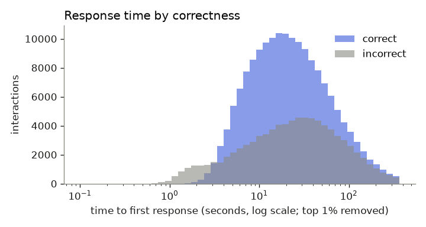

# EDA report: assist2009

_Generated by `ml/scripts/eda.py` from the processed data. Do not edit by hand; re-run the script._

## Cleaning

| Step | Rows | Students | Rows removed |
|---|---:|---:|---:|
| raw file | 346,860 | 4,217 |  |
| drop rows with no skill tag | 283,105 | 4,163 | 63,755 |
| drop answer types ['open_response'] | 283,097 | 4,163 | 8 |
| keep tutor modes ['tutor'] | 282,838 | 4,160 | 259 |
| keep main problems only (drop scaffolding) | 259,132 | 4,160 | 23,706 |

## Size

| Measure | Value |
|---|---:|
| Interactions | 259,132 |
| Students | 4,160 |
| Items (problems) | 15,920 |
| Concepts (skill tags) | 145 |
| Overall correct rate | 65.8% |
| Majority-class accuracy (always predict 'correct') | 65.8% |
| Has clock timestamps | no (order only) |
| Response time missing | 0.1% |

## Distributions

| Per | median | p10 | p90 | p99 | mean |
|---|---:|---:|---:|---:|---:|
| Interactions per student | 19 | 3 | 150 | 599 | 62.3 |
| Interactions per concept | 906 | 32 | 4288 | 15300 | 1787.1 |
| Interactions per item | 10 | 2 | 39 | 94 | 16.3 |

- 538 students have fewer than 5 interactions (cold-start cases).
- 4,231 of 15,920 items (27%) have fewer than 5 interactions; the median item has 10. Raw per-item difficulty is noisy for many items, so it must be smoothed towards the concept average. Difficulty is always fitted on training students only.

## Does past performance predict the next answer?

| Previous outcome on the same concept | P(correct) | 95% CI | n |
|---|---:|---|---:|
| previous incorrect | 0.485 | 0.481–0.488 | 81,035 |
| first attempt | 0.603 | 0.598–0.608 | 42,741 |
| previous correct | 0.779 | 0.777–0.781 | 135,356 |

After a correct answer, the next answer on that concept is correct 77.9% of the time, versus 48.5% after an incorrect one. This gap is the signal knowledge-tracing models exploit.

## Learning curve

P(correct) is 0.603 at the first opportunity (n = 42,741) and 0.643 at opportunity 20 (n = 2,150).

**Read with care: survivor bias.** In Skill Builder (mastery) assignments a student stops once they get 3 in a row right. Students still practising at high opportunity counts are disproportionately the ones who are struggling, so the pooled curve under-states how much individual students learn. A model must condition on each student's history rather than read the pooled curve.

## Students and items

## Response time

Median time to first response: 20.5 s for correct answers, 24.8 s for incorrect ones.

Answers faster than 3 s make up 3.5% of responses (n = 8,966) and are correct only 20.8% of the time, versus 67.4% for slower answers. This large gap is strong evidence of rapid guessing, and supports MENTORX's rule that answers under 3 s don't count towards streaks (SRS FR-ENG-02).

