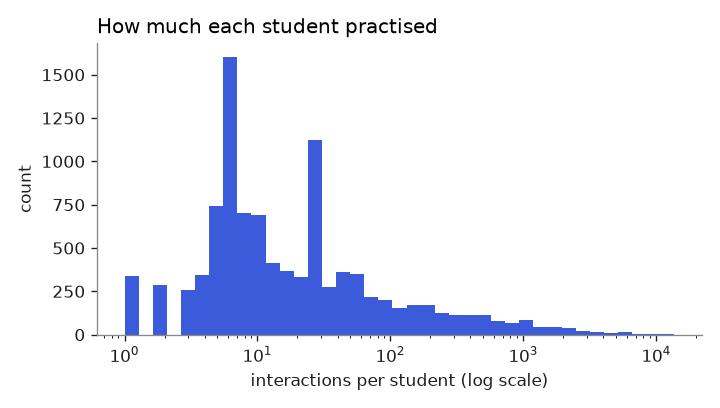
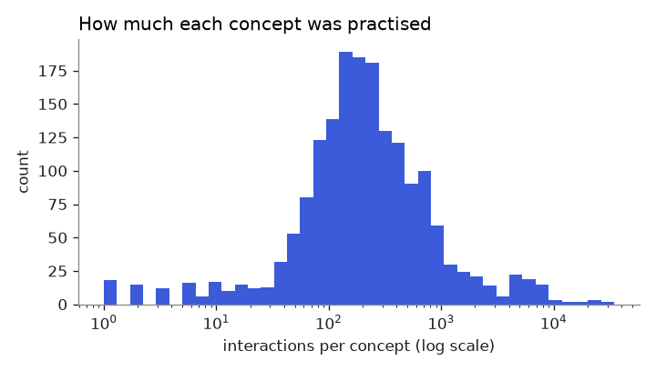
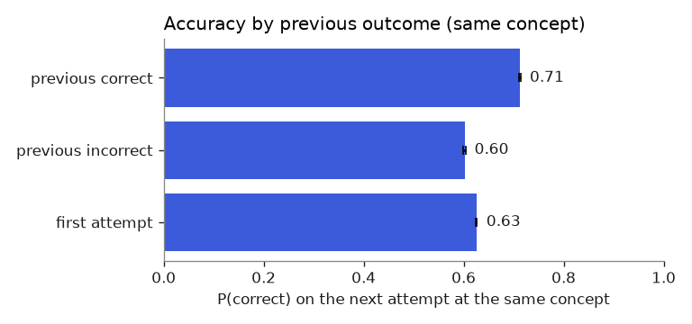
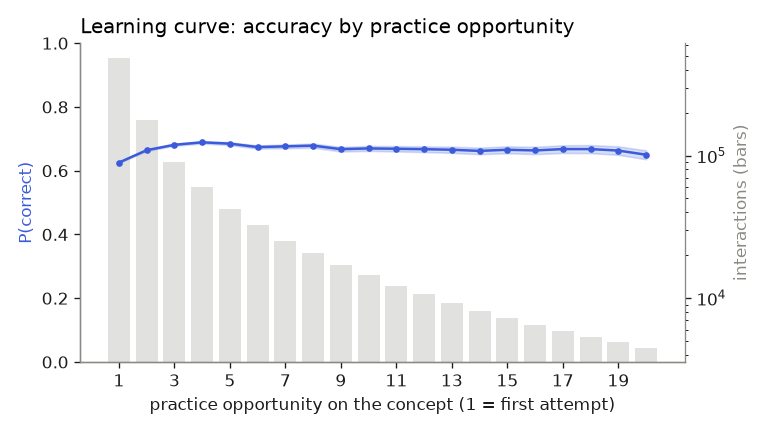
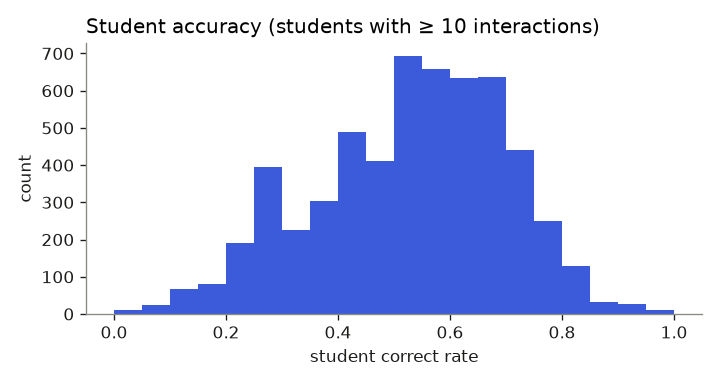
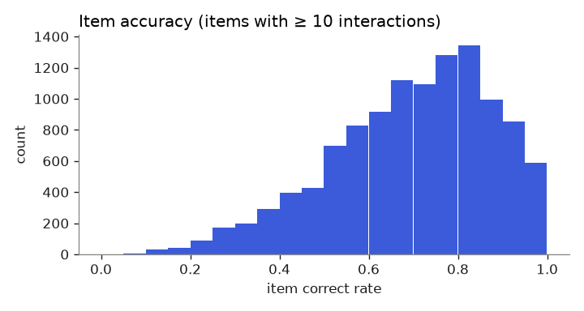
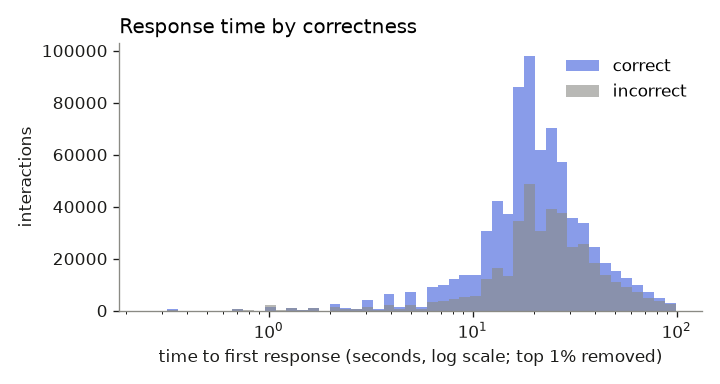

# EDA report: ednet

_Generated by `ml/scripts/eda.py` from the processed data. Do not edit by hand; re-run the script._

## Cleaning

| Step | Rows | Students | Rows removed |
|---|---:|---:|---:|
| sampled students (raw rows) | 1,144,377 | 10,000 |  |
| keep questions present in questions.csv | 1,144,377 | 10,000 | 0 |
| drop rows with no submitted answer | 1,144,108 | 10,000 | 269 |

## Size

| Measure | Value |
|---|---:|
| Interactions | 1,144,108 |
| Students | 10,000 |
| Items (problems) | 12,090 |
| Concepts (skill tags) | 1,779 |
| Overall correct rate | 65.3% |
| Majority-class accuracy (always predict 'correct') | 65.3% |
| Has clock timestamps | yes |
| Response time missing | 0.2% |

## Distributions

| Per | median | p10 | p90 | p99 | mean |
|---|---:|---:|---:|---:|---:|
| Interactions per student | 12 | 4 | 186 | 2001 | 114.4 |
| Interactions per concept | 201 | 46 | 962 | 7701 | 643.1 |
| Interactions per item | 59 | 14 | 194 | 587 | 94.6 |

- 1,233 students have fewer than 5 interactions (cold-start cases).
- 304 of 12,090 items (3%) have fewer than 5 interactions; the median item has 59. Most items have enough answers for a usable difficulty estimate; smoothing still protects the rare ones. Difficulty is always fitted on training students only.

## Does past performance predict the next answer?

| Previous outcome on the same concept | P(correct) | 95% CI | n |
|---|---:|---|---:|
| previous incorrect | 0.602 | 0.600–0.604 | 235,447 |
| first attempt | 0.626 | 0.624–0.627 | 486,337 |
| previous correct | 0.712 | 0.711–0.714 | 422,324 |

After a correct answer, the next answer on that concept is correct 71.2% of the time, versus 60.2% after an incorrect one. This gap is the signal knowledge-tracing models exploit.

## Learning curve

P(correct) is 0.626 at the first opportunity (n = 486,337) and 0.650 at opportunity 20 (n = 4,493).

**Read with care: survivor bias.** In Skill Builder (mastery) assignments a student stops once they get 3 in a row right. Students still practising at high opportunity counts are disproportionately the ones who are struggling, so the pooled curve under-states how much individual students learn. A model must condition on each student's history rather than read the pooled curve.

## Students and items

## Response time

Median time to first response: 20.0 s for correct answers, 23.0 s for incorrect ones.

Answers faster than 3 s make up 1.5% of responses (n = 17,637) and are correct only 52.8% of the time, versus 65.5% for slower answers. The gap is modest, so in this dataset many fast answers are genuine; a 3 s threshold alone would be a weak guessing detector here.

