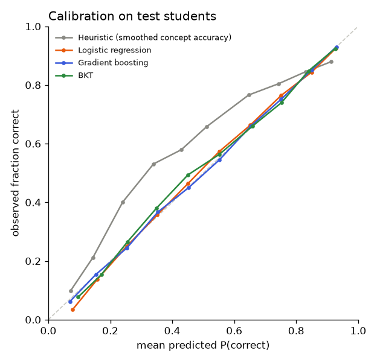

# Model comparison: assist2009

_Generated by `ml/scripts/train.py` and `ml/scripts/evaluate.py`. Do not edit by hand._

## Setup

- Data: `data/processed/assist2009.parquet`, sha256 `d658615e842e4c59…`
- Split by student (seed 42): train 2,912 students / 178,107 rows, val 624 students / 40,288 rows, test 624 students / 40,737 rows
- Features (14): `log_prior_concept`, `acc_concept`, `acc_concept_last3`, `prev_concept`, `is_first_concept`, `log_gap_concept`, `log_prior_overall`, `acc_overall`, `acc_overall_last10`, `log_prior_item`, `prev_item_correct`, `item_logit`, `concept_logit`, `log_item_count`
- History features use only each student's earlier answers; difficulty features are learned from training students only (cross-fitted for training rows). Leakage tests: `ml/tests/test_features.py`.

## Selection (on validation data, before the test set was scored)

Rule (pre-registered in the config): lowest validation **log_loss** among models with ECE ≤ 0.05 and scoring 50 candidates in ≤ 50 ms; `prior` is a reference only.

| Model | Best params | Val log loss | Val AUC | Val ECE | Latency (50) | Fit time |
|---|---|---:|---:|---:|---:|---:|
| Gradient boosting | learning_rate=0.05, max_leaf_nodes=63 | 0.5110 | 0.7758 | 0.0085 | 3.6 ms | 3 s |
| Logistic regression | C=10.0 | 0.5226 | 0.7642 | 0.0159 | 0.8 ms | 0 s |
| BKT | — | 0.5574 | 0.7151 | 0.0135 | 8.1 ms | 9 s |
| Heuristic (smoothed concept accuracy) | — | 0.6132 | 0.6837 | 0.1260 | 0.0 ms | 0 s |
| Prior (constant) | — | 0.6280 | 0.5000 | 0.0296 | 0.0 ms | 0 s |

**Selected: Gradient boosting** (selected at 2026-11-07T21:09:27+00:00).
Rejected by the rule: Heuristic (smoothed concept accuracy) (ECE 0.126 > 0.05)

## Test results (40,737 answers from 624 unseen students)

Point estimates with 95% bootstrap CIs (students resampled, 200 reps).

| Model | AUC | Log loss | Accuracy | F1 | Brier | ECE |
|---|---|---|---|---|---|---|
| Gradient boosting ⭐ | 0.775 (0.762–0.785) | 0.523 (0.513–0.534) | 0.743 (0.734–0.752) | 0.821 (0.811–0.830) | 0.174 (0.169–0.179) | 0.004 (0.004–0.009) |
| Logistic regression | 0.761 (0.748–0.772) | 0.535 (0.525–0.546) | 0.736 (0.727–0.745) | 0.815 (0.805–0.825) | 0.179 (0.174–0.183) | 0.011 (0.007–0.017) |
| BKT | 0.716 (0.703–0.727) | 0.569 (0.558–0.580) | 0.710 (0.699–0.721) | 0.800 (0.788–0.811) | 0.193 (0.188–0.198) | 0.013 (0.011–0.021) |
| Heuristic (smoothed concept accuracy) | 0.681 (0.664–0.695) | 0.623 (0.614–0.630) | 0.683 (0.671–0.695) | 0.772 (0.757–0.785) | 0.217 (0.213–0.220) | 0.120 (0.110–0.129) |
| Prior (constant) | 0.500 (0.500–0.500) | 0.639 (0.627–0.650) | 0.663 (0.646–0.683) | 0.798 (0.785–0.811) | 0.223 (0.218–0.229) | 0.012 (0.001–0.031) |

### Improvement over the heuristic (smoothed concept accuracy) (paired bootstrap)

| Model | Δ AUC (95% CI) | Δ log loss (95% CI) |
|---|---|---|
| Gradient boosting | +0.0936 (+0.0868 to +0.1007) | -0.0992 (-0.1054 to -0.0931) |
| Logistic regression | +0.0800 (+0.0743 to +0.0865) | -0.0872 (-0.0929 to -0.0813) |
| BKT | +0.0345 (+0.0306 to +0.0401) | -0.0532 (-0.0595 to -0.0465) |
| Prior (constant) | -0.1814 (-0.1948 to -0.1643) | +0.0164 (+0.0019 to +0.0293) |

An interval that excludes 0 means the difference is unlikely to be due to which students happened to be in the test set.

## What the models learned

### Logistic regression coefficients (standardised features)

| Feature | Coefficient |
|---|---:|
| `item_logit` | +0.645 |
| `acc_overall` | +0.379 |
| `is_first_concept` | -0.201 |
| `acc_overall_last10` | +0.194 |
| `prev_concept` | +0.183 |
| `acc_concept` | +0.140 |
| `acc_concept_last3` | +0.128 |
| `log_gap_concept` | -0.085 |
| `concept_logit` | -0.075 |
| `log_item_count` | -0.046 |
| `prev_item_correct` | +0.034 |
| `log_prior_overall` | -0.034 |
| `log_prior_concept` | -0.016 |
| `log_prior_item` | -0.007 |

### Gradient boosting permutation importance (increase in validation log loss)

| Feature | Importance |
|---|---:|
| `item_logit` | 0.0886 |
| `acc_overall` | 0.0278 |
| `concept_logit` | 0.0113 |
| `acc_concept_last3` | 0.0076 |
| `acc_overall_last10` | 0.0072 |
| `prev_concept` | 0.0068 |
| `log_prior_concept` | 0.0063 |
| `acc_concept` | 0.0061 |
| `log_item_count` | 0.0050 |
| `log_prior_overall` | 0.0050 |
| `log_gap_concept` | 0.0023 |
| `prev_item_correct` | 0.0002 |
| `is_first_concept` | -0.0000 |
| `log_prior_item` | -0.0001 |

### BKT parameters across 126 concepts (quartiles)

| Parameter | 25% | median | 75% |
|---|---:|---:|---:|
| p_init | 0.486 | 0.671 | 0.852 |
| p_learn | 0.086 | 0.172 | 0.280 |
| p_guess | 0.090 | 0.184 | 0.300 |
| p_slip | 0.124 | 0.206 | 0.280 |

## Test-set access log

| # | Evaluated at | Selected model |
|---|---|---|
| 1 | 2026-11-07T21:10:14+00:00 | gradient_boosting |
