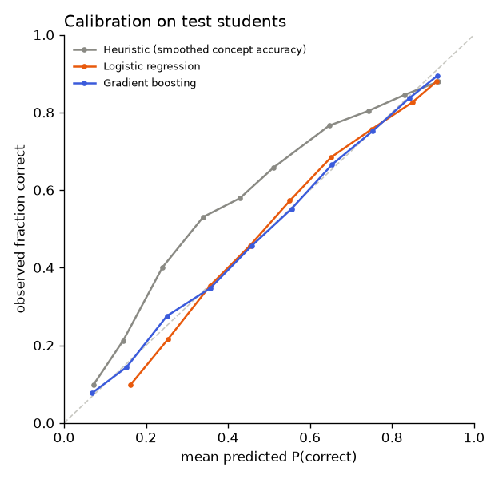

# Model comparison: assist2009_history_only

Ablation: history features only, with no difficulty features at all. Shows what the student's own answer history predicts by itself.

_Generated by `ml/scripts/train.py` and `ml/scripts/evaluate.py`. Do not edit by hand._

## Setup

- Data: `data/processed/assist2009.parquet`, sha256 `d658615e842e4c59…`
- Split by student (seed 42): train 2,912 students / 178,107 rows, val 624 students / 40,288 rows, test 624 students / 40,737 rows
- Features (11): `log_prior_concept`, `acc_concept`, `acc_concept_last3`, `prev_concept`, `is_first_concept`, `log_gap_concept`, `log_prior_overall`, `acc_overall`, `acc_overall_last10`, `log_prior_item`, `prev_item_correct`
- History features use only each student's earlier answers; difficulty features are learned from training students only (cross-fitted for training rows). Leakage tests: `ml/tests/test_features.py`.

## Selection (on validation data, before the test set was scored)

Rule (pre-registered in the config): lowest validation **log_loss** among models with ECE ≤ 0.05 and scoring 50 candidates in ≤ 50 ms; `prior` is a reference only.

| Model | Best params | Val log loss | Val AUC | Val ECE | Latency (50) | Fit time |
|---|---|---:|---:|---:|---:|---:|
| Gradient boosting | learning_rate=0.05, max_leaf_nodes=31 | 0.5489 | 0.7232 | 0.0078 | 2.3 ms | 2 s |
| Logistic regression | C=10.0 | 0.5551 | 0.7163 | 0.0219 | 0.7 ms | 0 s |
| Heuristic (smoothed concept accuracy) | — | 0.6132 | 0.6837 | 0.1260 | 0.0 ms | 0 s |
| Prior (constant) | — | 0.6280 | 0.5000 | 0.0296 | 0.0 ms | 0 s |

**Selected: Gradient boosting** (selected at 2026-11-07T21:11:36+00:00).
Rejected by the rule: Heuristic (smoothed concept accuracy) (ECE 0.126 > 0.05)

## Test results (40,737 answers from 624 unseen students)

Point estimates with 95% bootstrap CIs (students resampled, 200 reps).

| Model | AUC | Log loss | Accuracy | F1 | Brier | ECE |
|---|---|---|---|---|---|---|
| Gradient boosting ⭐ | 0.718 (0.698–0.732) | 0.564 (0.551–0.575) | 0.719 (0.708–0.731) | 0.811 (0.799–0.823) | 0.190 (0.185–0.195) | 0.006 (0.005–0.013) |
| Logistic regression | 0.713 (0.692–0.727) | 0.569 (0.557–0.580) | 0.718 (0.707–0.729) | 0.809 (0.797–0.821) | 0.192 (0.187–0.197) | 0.020 (0.014–0.027) |
| Heuristic (smoothed concept accuracy) | 0.681 (0.664–0.695) | 0.623 (0.614–0.630) | 0.683 (0.671–0.695) | 0.772 (0.757–0.785) | 0.217 (0.213–0.220) | 0.120 (0.110–0.129) |
| Prior (constant) | 0.500 (0.500–0.500) | 0.639 (0.627–0.650) | 0.663 (0.646–0.683) | 0.798 (0.785–0.811) | 0.223 (0.218–0.229) | 0.012 (0.001–0.031) |

### Improvement over the heuristic (smoothed concept accuracy) (paired bootstrap)

| Model | Δ AUC (95% CI) | Δ log loss (95% CI) |
|---|---|---|
| Gradient boosting | +0.0367 (+0.0318 to +0.0413) | -0.0589 (-0.0643 to -0.0536) |
| Logistic regression | +0.0313 (+0.0266 to +0.0358) | -0.0534 (-0.0591 to -0.0478) |
| Prior (constant) | -0.1814 (-0.1948 to -0.1643) | +0.0164 (+0.0019 to +0.0293) |

An interval that excludes 0 means the difference is unlikely to be due to which students happened to be in the test set.

## What the models learned

### Logistic regression coefficients (standardised features)

| Feature | Coefficient |
|---|---:|
| `acc_overall` | +0.291 |
| `acc_concept` | +0.254 |
| `is_first_concept` | -0.206 |
| `acc_overall_last10` | +0.206 |
| `prev_concept` | +0.184 |
| `acc_concept_last3` | +0.155 |
| `log_prior_concept` | -0.099 |
| `log_gap_concept` | -0.082 |
| `log_prior_overall` | -0.047 |
| `prev_item_correct` | +0.046 |
| `log_prior_item` | -0.011 |

### Gradient boosting permutation importance (increase in validation log loss)

| Feature | Importance |
|---|---:|
| `acc_overall` | 0.0187 |
| `acc_concept` | 0.0116 |
| `acc_concept_last3` | 0.0097 |
| `acc_overall_last10` | 0.0081 |
| `prev_concept` | 0.0079 |
| `log_prior_overall` | 0.0032 |
| `log_prior_concept` | 0.0022 |
| `log_gap_concept` | 0.0016 |
| `prev_item_correct` | 0.0005 |
| `is_first_concept` | 0.0000 |
| `log_prior_item` | 0.0000 |

## Test-set access log

| # | Evaluated at | Selected model |
|---|---|---|
| 1 | 2026-11-07T21:11:55+00:00 | gradient_boosting |
