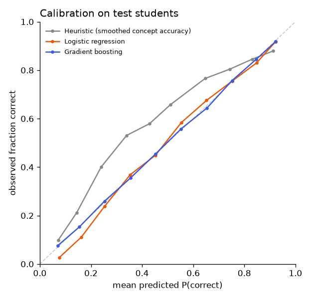

# Model comparison: assist2009_no_item_difficulty

Ablation: no item-level difficulty (item_logit, log_item_count). This is the situation of a brand-new question bank such as MENTORX's at launch, where only concept-level difficulty can be estimated.

_Generated by `ml/scripts/train.py` and `ml/scripts/evaluate.py`. Do not edit by hand._

## Setup

- Data: `data/processed/assist2009.parquet`, sha256 `d658615e842e4c59…`
- Split by student (seed 42): train 2,912 students / 178,107 rows, val 624 students / 40,288 rows, test 624 students / 40,737 rows
- Features (12): `log_prior_concept`, `acc_concept`, `acc_concept_last3`, `prev_concept`, `is_first_concept`, `log_gap_concept`, `log_prior_overall`, `acc_overall`, `acc_overall_last10`, `log_prior_item`, `prev_item_correct`, `concept_logit`
- History features use only each student's earlier answers; difficulty features are learned from training students only (cross-fitted for training rows). Leakage tests: `ml/tests/test_features.py`.

## Selection (on validation data, before the test set was scored)

Rule (pre-registered in the config): lowest validation **log_loss** among models with ECE ≤ 0.05 and scoring 50 candidates in ≤ 50 ms; `prior` is a reference only.

| Model | Best params | Val log loss | Val AUC | Val ECE | Latency (50) | Fit time |
|---|---|---:|---:|---:|---:|---:|
| Gradient boosting | learning_rate=0.05, max_leaf_nodes=63 | 0.5310 | 0.7492 | 0.0104 | 3.3 ms | 2 s |
| Logistic regression | C=10.0 | 0.5415 | 0.7378 | 0.0177 | 0.6 ms | 0 s |
| Heuristic (smoothed concept accuracy) | — | 0.6132 | 0.6837 | 0.1260 | 0.0 ms | 0 s |
| Prior (constant) | — | 0.6280 | 0.5000 | 0.0296 | 0.0 ms | 0 s |

**Selected: Gradient boosting** (selected at 2026-11-07T21:11:02+00:00).
Rejected by the rule: Heuristic (smoothed concept accuracy) (ECE 0.126 > 0.05)

## Test results (40,737 answers from 624 unseen students)

Point estimates with 95% bootstrap CIs (students resampled, 200 reps).

| Model | AUC | Log loss | Accuracy | F1 | Brier | ECE |
|---|---|---|---|---|---|---|
| Gradient boosting ⭐ | 0.746 (0.732–0.757) | 0.546 (0.534–0.557) | 0.729 (0.718–0.740) | 0.815 (0.803–0.826) | 0.183 (0.178–0.188) | 0.005 (0.004–0.010) |
| Logistic regression | 0.733 (0.717–0.746) | 0.556 (0.544–0.567) | 0.726 (0.716–0.736) | 0.811 (0.800–0.822) | 0.187 (0.182–0.192) | 0.015 (0.011–0.022) |
| Heuristic (smoothed concept accuracy) | 0.681 (0.664–0.695) | 0.623 (0.614–0.630) | 0.683 (0.671–0.695) | 0.772 (0.757–0.785) | 0.217 (0.213–0.220) | 0.120 (0.110–0.129) |
| Prior (constant) | 0.500 (0.500–0.500) | 0.639 (0.627–0.650) | 0.663 (0.646–0.683) | 0.798 (0.785–0.811) | 0.223 (0.218–0.229) | 0.012 (0.001–0.031) |

### Improvement over the heuristic (smoothed concept accuracy) (paired bootstrap)

| Model | Δ AUC (95% CI) | Δ log loss (95% CI) |
|---|---|---|
| Gradient boosting | +0.0643 (+0.0594 to +0.0697) | -0.0767 (-0.0829 to -0.0711) |
| Logistic regression | +0.0518 (+0.0477 to +0.0561) | -0.0666 (-0.0721 to -0.0613) |
| Prior (constant) | -0.1814 (-0.1948 to -0.1643) | +0.0164 (+0.0019 to +0.0293) |

An interval that excludes 0 means the difference is unlikely to be due to which students happened to be in the test set.

## What the models learned

### Logistic regression coefficients (standardised features)

| Feature | Coefficient |
|---|---:|
| `concept_logit` | +0.408 |
| `acc_overall` | +0.366 |
| `is_first_concept` | -0.199 |
| `acc_overall_last10` | +0.190 |
| `prev_concept` | +0.187 |
| `acc_concept_last3` | +0.146 |
| `acc_concept` | +0.127 |
| `log_gap_concept` | -0.076 |
| `log_prior_concept` | -0.047 |
| `prev_item_correct` | +0.045 |
| `log_prior_overall` | -0.022 |
| `log_prior_item` | -0.017 |

### Gradient boosting permutation importance (increase in validation log loss)

| Feature | Importance |
|---|---:|
| `concept_logit` | 0.0398 |
| `acc_overall` | 0.0269 |
| `prev_concept` | 0.0085 |
| `acc_overall_last10` | 0.0080 |
| `acc_concept_last3` | 0.0080 |
| `acc_concept` | 0.0067 |
| `log_prior_concept` | 0.0050 |
| `log_prior_overall` | 0.0047 |
| `log_gap_concept` | 0.0024 |
| `prev_item_correct` | 0.0006 |
| `is_first_concept` | 0.0000 |
| `log_prior_item` | 0.0000 |

## Test-set access log

| # | Evaluated at | Selected model |
|---|---|---|
| 1 | 2026-11-07T21:11:21+00:00 | gradient_boosting |
