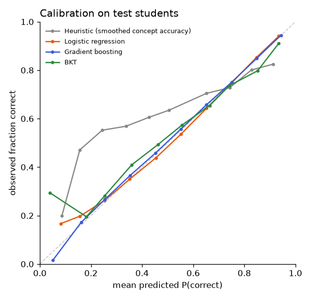

# Model comparison: ednet

EdNet-KT1 sample with real timestamps, so the time-since-practice features (log_secs_since_concept, log_secs_since_any) are included.

_Generated by `ml/scripts/train.py` and `ml/scripts/evaluate.py`. Do not edit by hand._

## Setup

- Data: `data/processed/ednet.parquet`, sha256 `2342b03dfebabdf8…`
- Split by student (seed 42): train 7,000 students / 777,427 rows, val 1,500 students / 175,828 rows, test 1,500 students / 190,853 rows
- Features (16): `log_prior_concept`, `acc_concept`, `acc_concept_last3`, `prev_concept`, `is_first_concept`, `log_gap_concept`, `log_prior_overall`, `acc_overall`, `acc_overall_last10`, `log_prior_item`, `prev_item_correct`, `log_secs_since_concept`, `log_secs_since_any`, `item_logit`, `concept_logit`, `log_item_count`
- History features use only each student's earlier answers; difficulty features are learned from training students only (cross-fitted for training rows). Leakage tests: `ml/tests/test_features.py`.

## Selection (on validation data, before the test set was scored)

Rule (pre-registered in the config): lowest validation **log_loss** among models with ECE ≤ 0.05 and scoring 50 candidates in ≤ 50 ms; `prior` is a reference only.

| Model | Best params | Val log loss | Val AUC | Val ECE | Latency (50) | Fit time |
|---|---|---:|---:|---:|---:|---:|
| Gradient boosting | learning_rate=0.1, max_leaf_nodes=63 | 0.5280 | 0.7677 | 0.0088 | 5.0 ms | 12 s |
| Logistic regression | C=0.01 | 0.5444 | 0.7510 | 0.0065 | 0.7 ms | 1 s |
| BKT | — | 0.6030 | 0.6540 | 0.0166 | 24.4 ms | 84 s |
| Prior (constant) | — | 0.6368 | 0.5000 | 0.0186 | 0.0 ms | 0 s |
| Heuristic (smoothed concept accuracy) | — | 0.6675 | 0.5708 | 0.1183 | 0.0 ms | 0 s |

**Selected: Gradient boosting** (selected at 2026-11-07T21:19:44+00:00).
Rejected by the rule: Heuristic (smoothed concept accuracy) (ECE 0.118 > 0.05)

## Test results (190,853 answers from 1,500 unseen students)

Point estimates with 95% bootstrap CIs (students resampled, 200 reps).

| Model | AUC | Log loss | Accuracy | F1 | Brier | ECE |
|---|---|---|---|---|---|---|
| Gradient boosting ⭐ | 0.771 (0.763–0.780) | 0.532 (0.518–0.546) | 0.729 (0.718–0.740) | 0.807 (0.792–0.820) | 0.179 (0.173–0.185) | 0.004 (0.003–0.012) |
| Logistic regression | 0.752 (0.744–0.759) | 0.551 (0.536–0.565) | 0.717 (0.705–0.728) | 0.803 (0.790–0.816) | 0.186 (0.180–0.192) | 0.009 (0.006–0.017) |
| BKT | 0.642 (0.633–0.653) | 0.616 (0.601–0.631) | 0.670 (0.655–0.687) | 0.782 (0.767–0.796) | 0.213 (0.206–0.220) | 0.019 (0.015–0.030) |
| Prior (constant) | 0.500 (0.500–0.500) | 0.645 (0.633–0.657) | 0.655 (0.635–0.673) | 0.791 (0.777–0.805) | 0.226 (0.221–0.232) | 0.006 (0.000–0.024) |
| Heuristic (smoothed concept accuracy) | 0.566 (0.551–0.581) | 0.675 (0.663–0.685) | 0.631 (0.617–0.647) | 0.754 (0.737–0.768) | 0.241 (0.236–0.245) | 0.117 (0.107–0.127) |

### Improvement over the heuristic (smoothed concept accuracy) (paired bootstrap)

| Model | Δ AUC (95% CI) | Δ log loss (95% CI) |
|---|---|---|
| Gradient boosting | +0.2053 (+0.1934 to +0.2183) | -0.1433 (-0.1513 to -0.1337) |
| Logistic regression | +0.1858 (+0.1736 to +0.1986) | -0.1244 (-0.1318 to -0.1151) |
| BKT | +0.0756 (+0.0621 to +0.0891) | -0.0586 (-0.0681 to -0.0484) |
| Prior (constant) | -0.0662 (-0.0809 to -0.0513) | -0.0303 (-0.0388 to -0.0198) |

An interval that excludes 0 means the difference is unlikely to be due to which students happened to be in the test set.

## What the models learned

### Logistic regression coefficients (standardised features)

| Feature | Coefficient |
|---|---:|
| `item_logit` | +0.924 |
| `acc_overall` | +0.341 |
| `prev_item_correct` | +0.251 |
| `is_first_concept` | -0.155 |
| `log_gap_concept` | -0.130 |
| `acc_overall_last10` | +0.121 |
| `concept_logit` | -0.101 |
| `acc_concept` | +0.096 |
| `log_item_count` | +0.066 |
| `log_prior_overall` | -0.062 |
| `log_secs_since_concept` | -0.052 |
| `log_prior_item` | +0.048 |
| `log_prior_concept` | -0.024 |
| `log_secs_since_any` | -0.015 |
| `prev_concept` | +0.014 |
| `acc_concept_last3` | -0.009 |

### Gradient boosting permutation importance (increase in validation log loss)

| Feature | Importance |
|---|---:|
| `item_logit` | 0.1502 |
| `acc_overall` | 0.0326 |
| `prev_item_correct` | 0.0269 |
| `log_secs_since_concept` | 0.0138 |
| `log_prior_item` | 0.0127 |
| `log_prior_overall` | 0.0055 |
| `log_secs_since_any` | 0.0047 |
| `log_item_count` | 0.0045 |
| `acc_concept` | 0.0027 |
| `acc_overall_last10` | 0.0026 |
| `log_gap_concept` | 0.0024 |
| `log_prior_concept` | 0.0022 |
| `concept_logit` | 0.0022 |
| `prev_concept` | 0.0012 |
| `acc_concept_last3` | 0.0005 |
| `is_first_concept` | 0.0000 |

### BKT parameters across 1467 concepts (quartiles)

| Parameter | 25% | median | 75% |
|---|---:|---:|---:|
| p_init | 0.631 | 0.813 | 0.928 |
| p_learn | 0.155 | 0.491 | 0.500 |
| p_guess | 0.151 | 0.300 | 0.300 |
| p_slip | 0.061 | 0.154 | 0.247 |

## Test-set access log

| # | Evaluated at | Selected model |
|---|---|---|
| 1 | 2026-11-07T21:22:08+00:00 | gradient_boosting |
