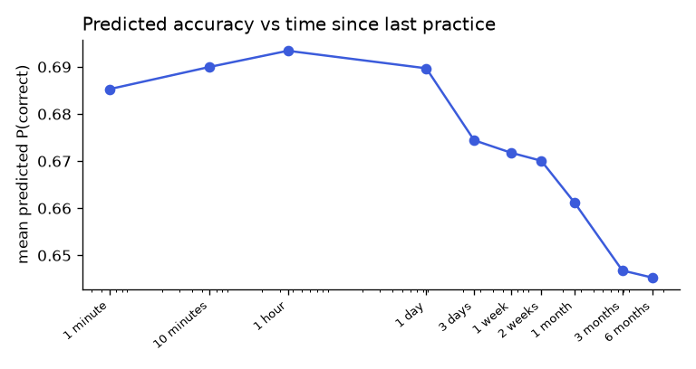

# Time response: ednet (gradient_boosting)

_Generated by `ml/scripts/time_response.py`._

Partial dependence on `log_secs_since_concept`, averaged over 20,000 validation answers where the concept had been practised before (all other features unchanged).

| Time since last practice | Mean predicted P(correct) |
|---|---:|
| 1 minute | 0.685 |
| 10 minutes | 0.690 |
| 1 hour | 0.693 |
| 1 day | 0.690 |
| 3 days | 0.674 |
| 1 week | 0.672 |
| 2 weeks | 0.670 |
| 1 month | 0.661 |
| 3 months | 0.647 |
| 6 months | 0.645 |

Peak 0.693 at 1 hour; 0.645 after 6 months (-0.048).

**Caveat:** this is observational data. Students who come back after a long gap may differ from those who don't, so the curve shows what the model learned, not a controlled forgetting experiment.

