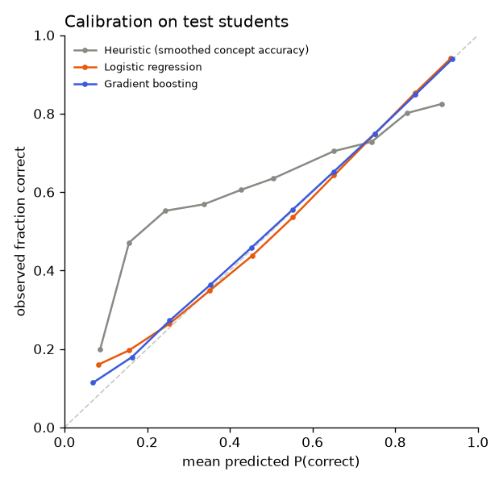

# Model comparison: ednet_no_time

Ablation: EdNet without the two time features. Comparing with the `ednet` run (same students, same split) shows how much knowing elapsed time improves prediction, which is the basis for MENTORX's mastery decay and revision scheduling.

_Generated by `ml/scripts/train.py` and `ml/scripts/evaluate.py`. Do not edit by hand._

## Setup

- Data: `data/processed/ednet.parquet`, sha256 `2342b03dfebabdf8…`
- Split by student (seed 42): train 7,000 students / 777,427 rows, val 1,500 students / 175,828 rows, test 1,500 students / 190,853 rows
- Features (14): `log_prior_concept`, `acc_concept`, `acc_concept_last3`, `prev_concept`, `is_first_concept`, `log_gap_concept`, `log_prior_overall`, `acc_overall`, `acc_overall_last10`, `log_prior_item`, `prev_item_correct`, `item_logit`, `concept_logit`, `log_item_count`
- History features use only each student's earlier answers; difficulty features are learned from training students only (cross-fitted for training rows). Leakage tests: `ml/tests/test_features.py`.

## Selection (on validation data, before the test set was scored)

Rule (pre-registered in the config): lowest validation **log_loss** among models with ECE ≤ 0.05 and scoring 50 candidates in ≤ 50 ms; `prior` is a reference only.

| Model | Best params | Val log loss | Val AUC | Val ECE | Latency (50) | Fit time |
|---|---|---:|---:|---:|---:|---:|
| Gradient boosting | learning_rate=0.05, max_leaf_nodes=63 | 0.5376 | 0.7594 | 0.0086 | 7.0 ms | 23 s |
| Logistic regression | C=0.01 | 0.5445 | 0.7509 | 0.0061 | 0.9 ms | 1 s |
| Prior (constant) | — | 0.6368 | 0.5000 | 0.0186 | 0.0 ms | 0 s |
| Heuristic (smoothed concept accuracy) | — | 0.6675 | 0.5708 | 0.1183 | 0.0 ms | 0 s |

**Selected: Gradient boosting** (selected at 2026-11-07T21:24:09+00:00).
Rejected by the rule: Heuristic (smoothed concept accuracy) (ECE 0.118 > 0.05)

## Test results (190,853 answers from 1,500 unseen students)

Point estimates with 95% bootstrap CIs (students resampled, 200 reps).

| Model | AUC | Log loss | Accuracy | F1 | Brier | ECE |
|---|---|---|---|---|---|---|
| Gradient boosting ⭐ | 0.762 (0.754–0.769) | 0.542 (0.528–0.555) | 0.723 (0.712–0.733) | 0.802 (0.788–0.816) | 0.183 (0.177–0.188) | 0.004 (0.003–0.012) |
| Logistic regression | 0.752 (0.744–0.759) | 0.551 (0.536–0.565) | 0.717 (0.705–0.729) | 0.803 (0.790–0.816) | 0.186 (0.180–0.192) | 0.009 (0.006–0.017) |
| Prior (constant) | 0.500 (0.500–0.500) | 0.645 (0.633–0.657) | 0.655 (0.635–0.673) | 0.791 (0.777–0.805) | 0.226 (0.221–0.232) | 0.006 (0.000–0.024) |
| Heuristic (smoothed concept accuracy) | 0.566 (0.551–0.581) | 0.675 (0.663–0.685) | 0.631 (0.617–0.647) | 0.754 (0.737–0.768) | 0.241 (0.236–0.245) | 0.117 (0.107–0.127) |

### Improvement over the heuristic (smoothed concept accuracy) (paired bootstrap)

| Model | Δ AUC (95% CI) | Δ log loss (95% CI) |
|---|---|---|
| Gradient boosting | +0.1961 (+0.1833 to +0.2095) | -0.1330 (-0.1405 to -0.1248) |
| Logistic regression | +0.1859 (+0.1735 to +0.1986) | -0.1244 (-0.1318 to -0.1151) |
| Prior (constant) | -0.0662 (-0.0809 to -0.0513) | -0.0303 (-0.0388 to -0.0198) |

An interval that excludes 0 means the difference is unlikely to be due to which students happened to be in the test set.

## What the models learned

### Logistic regression coefficients (standardised features)

| Feature | Coefficient |
|---|---:|
| `item_logit` | +0.923 |
| `acc_overall` | +0.340 |
| `prev_item_correct` | +0.251 |
| `log_gap_concept` | -0.168 |
| `is_first_concept` | -0.138 |
| `acc_overall_last10` | +0.121 |
| `concept_logit` | -0.101 |
| `acc_concept` | +0.097 |
| `log_item_count` | +0.065 |
| `log_prior_overall` | -0.058 |
| `log_prior_item` | +0.048 |
| `log_prior_concept` | -0.025 |
| `prev_concept` | +0.015 |
| `acc_concept_last3` | -0.008 |

### Gradient boosting permutation importance (increase in validation log loss)

| Feature | Importance |
|---|---:|
| `item_logit` | 0.1503 |
| `acc_overall` | 0.0305 |
| `prev_item_correct` | 0.0218 |
| `log_prior_item` | 0.0143 |
| `log_gap_concept` | 0.0082 |
| `log_prior_overall` | 0.0067 |
| `log_item_count` | 0.0056 |
| `acc_overall_last10` | 0.0028 |
| `concept_logit` | 0.0025 |
| `acc_concept` | 0.0024 |
| `log_prior_concept` | 0.0019 |
| `acc_concept_last3` | 0.0004 |
| `prev_concept` | 0.0002 |
| `is_first_concept` | 0.0000 |

## Test-set access log

| # | Evaluated at | Selected model |
|---|---|---|
| 1 | 2026-11-07T21:26:03+00:00 | gradient_boosting |
